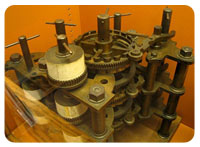

**Charles Babbage** was a true genius of his time, a brilliant inventor, a hero straight out of **Goethe**: he was ready to sell his soul to the devil just to peek "behind the scenes" of the universe. We remember him for the "Analytical Engine". Following in the footsteps of the great **Pascal**, he tried to bring to life the thing that today gathers dust in every home. And while the former invented no more than an elaborate abacus, Babbage was many years ahead of his time and anticipated the creation of computing machines.

Like many great scientists, Babbage saw the root of evil in one thing — inaccurate calculations. In those days people usually relied on tables of precomputed values of various functions. Need the sine of 23 degrees? Open page 32. The table values were computed by people with pen and paper; people made mistakes, the mistakes accumulated, and Babbage was indignant. After he discussed the problem with the astronomer **Herschel** yet again, his patience ran out. By then he already had a couple of papers that carefully analyzed the losses the state suffered because of "bad" numbers, and he decided to put an end to the problem once and for all.

After long and painful searching he came up with the idea of the "Difference Engine". The machine was supposed to compute the values of some function at successive points — for example, $f(x) = x^2$ for $x = 1..10$. Several questions immediately arise, all boiling down to one: "How do you make a heap of scrap metal do that?" Even today, with a PC and a programming language, we would have to write some sort of recursive expression analyzer (a parser), solve the problem of representing transcendental functions (sine, logarithm), and then compute all the values in a loop. Fortunately, the second problem had been solved long before Babbage, by **Taylor** series. How he solved the first one is what I'll try to explain here; the last one we'll leave to the mechanics.

Take the simplest function, $f(x) = ax + b$, and build this table:

| x | f(x) | Δf |
| --- | --- | --- |
| 1 | a·1+b | a |
| 2 | a·2+b | a |
| 3 | a·3+b | a |
| 4 | a·4+b | – |

The third column is built using the formula $\Delta f = f(x+h) - f(x)$ with $h = 1$; it represents the average rate of change of the function, which is constant for a linear function. If we let $h$ tend to zero, we get the differential, which is related to $\Delta f$ as $\Delta f = (f'(x) + \varepsilon)\,h$, i.e. differs from $\Delta f$ by an infinitesimal of higher order. In our elementary example it's clear that to get the value at the next point it's enough to add the constant $a$. There it is — **the main idea**. If we have a polynomial of degree $n$, we can build all the differences up to order $n$ and then compute recursively. Let's clarify with an example.

Suppose we want to compute the values of $f(x) = x^3$ at the points $x = 2..2.5$ with step $h = 0.1$. Now we build a table:

| x | f(x) | Δf | Δ²f | Δ³f |
| --- | --- | --- | --- | --- |
| 2 | 8.000 | 1.261 | 0.126 | 0.006 |
| 2.1 | 9.261 | 1.387 | 0.132 | 0.006 |
| 2.2 | 10.648 | 1.519 | 0.138 | 0.006 |
| 2.3 | 12.167 | 1.657 | 0.144 | – |
| 2.4 | 13.824 | 1.801 | – | – |
| 2.5 | 15.625 | – | – | – |

As the table shows, the values in the last column are all the same, and that is good. It means we only need to compute the values of the first row (by hand) and can then move on row by row. Here is **the rule**: the value in a given cell equals the sum of the values in the cell above and the cell above-right. For example:

9.261 = 8.000 + 1.261;

1.387 = 1.261 + 0.126;

0.132 = 0.126 + 0.006.

That is exactly what Babbage implemented, and that is why his machine was called the difference (or analytical) engine. It's worth noting that his machine had only 8 memory cells, so it could only evaluate polynomials of degree $n \le 8$. Each cell was represented by 31 gears and could hold a value the size of a double word. The machine was supposed to run on steam; it was the scientist's son who eventually got it working.

An interesting fact is that already in those years Babbage correctly guessed the architecture of future computers. Only his processor was called the mill, the memory — the store, and the bus was a prototype of **Ford**'s assembly line. But how could one ask more of him?
