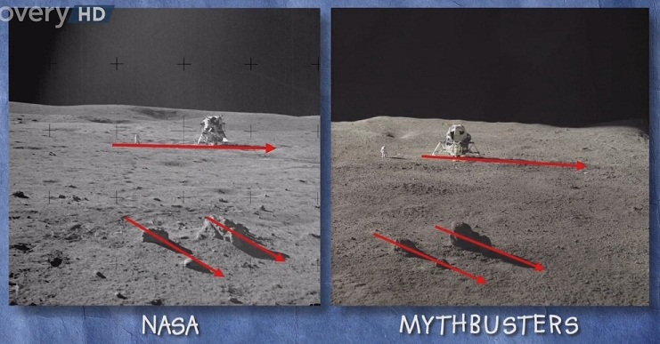
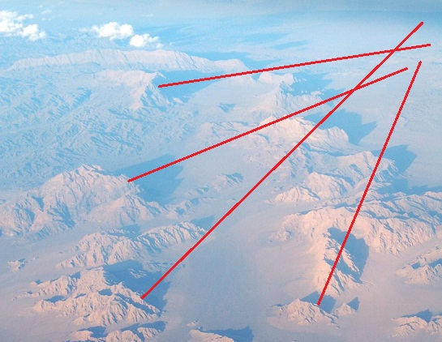
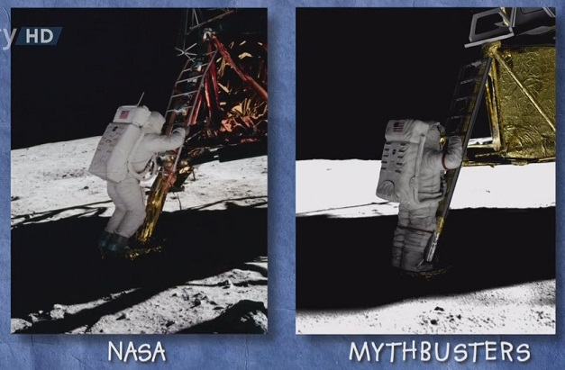
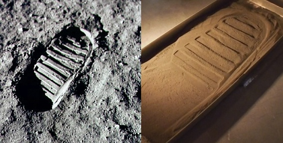
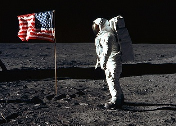
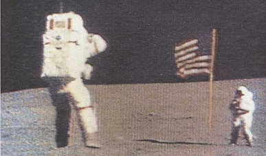

Ha, did you really think I was going to write about that? Oh, come on, enough already. There's no more mundane and hackneyed topic in nature.

Actually, I was going to tell you about the best episode of [*MythBusters*](https://en.wikipedia.org/wiki/MythBusters). The show, like many others, was created first and foremost to entertain the public; everything in it is soaked in Hollywood. Explosions, spectacle, explosions! Many of the experiments are fun, of course; a few have something to do with science, and others are downright anti-scientific, but more on that some other time. Come to think of it, it wasn't even worth writing about. But people try, and sometimes they succeed: meet episode number 104, "NASA Moon Landing".

Jamie and Adam decided to dispel some aspects of the most popular conspiracy theory, whose central claim is that during the "Moon race" no humans were actually landed on the Moon in the American Apollo program (1969–1972), and that the photographs, films and other documentary materials of the first landing, or of all six, were faked by the US government and NASA.

*Faked photographs*

In Adam's own words:

— Some people claim that it's the photographs that are the obvious proof this all took place in a studio, not on the Moon.

Did Nicéphore Niépce, the inventor and pioneer of photography, suspect how much noise his discovery would make in the future? I don't think so. The MythBusters picked two fairly well-known photographs with tilted horizons and strange shadows. In the first, the shadow of the lunar module and the shadows of the hills refused to lie parallel, which is certainly confusing and leads to the suspicion that everything was shot in a cozy studio with two different light sources. To bust the myth, the guys recreated the lunar surface on a table and lovingly placed a toy lander and model ravines on it. They used a studio spotlight as the Sun. It turned out that a simple change in the topography of the ravines is enough to make the shadows turn by that damned angle.

I, in turn, decided to try to find something similar on our home planet and started googling aerial photos of deserts. After a short search I came across a mountainous plateau in central Iran:

So there. The second controversial picture shows an astronaut uncertainly climbing down the ladder. All good, except he's awfully well lit for a guy standing in the shadow of the lunar module. Adam and Jamie had a scale model of the spacecraft with an astronaut in their stash. They made the lunar soil out of concrete mixed with coal dust — you couldn't tell it from the real thing. But the main point is that their new mixture had the same albedo as lunar regolith (7–8%). This is crucial, since direct sunlight couldn't reach the pioneer; the darkness could only be dispelled by light reflected from the surface. This time, too, Adam succeeded: he managed to get a picture that was practically a copy of the original. Glory to Neil Armstrong and his toy replica!

Long ago I heard an interesting hypothesis that the American flight to the Moon was directed by the immortal [Stanley Kubrick](https://en.wikipedia.org/wiki/Stanley_Kubrick). Supposedly it was nothing new to him, since exactly a year before the epochal events he had made *2001: A Space Odyssey*, in which he laid out star travel 33 years ahead. It really is an outstanding film, both in meaning and visually. They say Kubrick consulted NASA specialists during the shoot, and even tried to take out insurance in case an extraterrestrial civilization was discovered before the premiere. Another interesting fact concerns a different film of his. In *Barry Lyndon*, a historical picture, Kubrick refused to use artificial lighting when shooting in dark interiors. All the evening scenes were shot by candlelight, which became possible thanks to so-called Zeiss lenses used by NASA astronomers to observe the stars.

*Dealing with the vacuum*

The adepts of the conspiracy theory have two more interesting claims up their sleeve: the waving flag and the extremely sharp footprints the astronauts left on the surface with their boots. In the first case, an ordinary flag made of a piece of fabric should simply have drooped, because a vacuum implies no windy weather; and as for the footprints, there's nothing to say: the microparticles of soil with no moisture in it cling to each other very poorly and are unable to hold such sharp shapes. But the MythBusters decided to start with a different experiment: testing Galileo's classic experiment.

Galileo is known not only for his principle of inertia, which later became Newton's first law, and not only for inventing the telescope. He also taught that the acceleration of free fall does not depend on a body's weight. The classic experiment: a feather and a weight reach the ground at the same moment if air resistance is ignored.

The commander of Apollo 15, David Scott, carried out Galileo's experiment, and did it under ideal conditions, i.e. in a vacuum. The outcome was as expected. Of course, this isn't a fact conspiracy theorists use in their arguments — but maybe NASA committed a double falsification, and not only never went to the Moon but also, through cunning manipulation, performed Galileo's erroneous thought experiment? At the space research center in Alabama, using a vacuum chamber and the canonical ingredients (a feather and a hammer), the MythBusters saved Galileo's honor, hooray!

Now let's go back to the footprint and try to figure it out. Soil on Earth — sand, for example — differs considerably from what lies peacefully on the Moon. The latter even has a special name: regolith. The encyclopedia says that [regolith](https://en.wikipedia.org/wiki/Regolith) is a layer of fragmental debris and dust of varying grain size, consisting of lunar rocks and minerals, glass, lithified breccias, and meteorite fragments. But the most important difference is the microstructure of the material. Particles on Earth have been subject throughout their history — billions of years — to natural processes that tend to give them the smoothest and most streamlined shape possible, i.e. the shape of a ball. Naturally, without moisture such material can't take on an intricate shape, such as the tread pattern of a sole. Lunar soil, on the other hand, is pristine material whose microparticles have extremely asymmetric shapes. And this means, of course, that regolith has excellent natural "stickiness".

In one book I read that regolith is a very real problem for astronauts. It gets freely into every joint and crevice of the suit, scratches the helmet visor beautifully and can easily damage expensive equipment. After each EVA (Extra-Vehicular Activity — work outside the spacecraft), the Apollo crew members had to spend a long time cleaning the annoying lunar sand off their suits.

The MythBusters obtained a couple of kilograms of the precious substance — not the original, of course, just a copy with similar properties. No wonder: today probably only antimatter is harder to get than regolith. The experiment was carried out in a vacuum chamber using a mechanical drop rig whose job was to leave a footprint in the soil.

Quite convincing, don't you think?

Now it's the flag's turn. It's worth noting right away that NASA hardly employs, or ever employed, complete idiots and amateurs. Of course they couldn't send an ordinary flag made of a simple piece of fabric with an Apollo mission. Besides the flagpole, the space flag's skeleton included a perpendicular crossbar that kept the fabric from drooping. So what's left of the myth? That the flag not only kept its shape perfectly but also fluttered terribly.

Let's lay it all out. If you screw a flagpole into the ground in windless weather, the oscillations of the flag will quickly die down, since the energy goes into fighting air resistance. If you move the experiment to ideal conditions, i.e. to the Moon, the energy will be spent much more economically, so the flag should flutter noticeably longer. So what's bothering the conspiracy theorists?

The MythBusters did without any theoretical calculations and simply performed both experiments. Indeed, in a vacuum the flag not only moves chaotically, it does so for a demonstratively long time.

***Moonwalk***

— They claim that the footage of astronauts bouncing in the Moon's gravitational field, which is six times weaker than we're used to, was shot here on Earth. They just filmed everything with a high-speed camera, and that's how the movements came out smooth and slow, — Adam said.

Where to start this time? We could, for example, calculate how long an astronaut should be in free fall on the Moon and compare it with the same time on Earth. Suppose the astronaut jumps half a meter up. According to the simple formula $t = \sqrt{2S/g}$, the subsequent fall would take [0.319](http://www.wolframalpha.com/input/?i=sqrt(2*0.5m/(9.8m/s^2))) seconds on Earth and [0.782](http://www.wolframalpha.com/input/?i=sqrt(2*0.5m/(9.8m/s^2)*6)) seconds on the Moon, almost two and a half times longer. There's our slow-down factor.

Now let's imagine the moonwalk really was staged somewhere in Nevada. Then the director would have had to shoot everything at 60 frames per second (24 times 2.5). Great, we have an astronaut slowly coming down, just like on the Moon. But besides that he makes lots of other movements, for example the accompanying arm movements — and those are also slowed down 2.5 times, which should end up looking completely unnatural. If you take the [first](http://www.youtube.com/watch?v=MCa31VeHPbA) video of lunar jumps you find, you can see how fast the arms move compared to the overall slow fall. And an astronaut isn't just a suit with arms: a bunch of hefty tools hang from his belt, and in some videos you can see them dancing at a furious pace as he walks. As a result, filming something like this on Earth would be extremely difficult, to say the least.

Adam and Jamie came to similar results. Simple slow motion didn't look natural. They also tried a suspension rig that lifted Adam as he jumped, but still weren't satisfied. Their modest budget, of course, didn't allow them to move the tests to the Moon, but there was enough money for an airplane that can fly a parabola and thus simulate different free-fall coefficients inside the cabin. Adam's movements finally looked natural!

And now it's time for quotes, this time from the entertaining book *Marswalk One: First Steps on a New Planet* by one Shayler:

> The astronauts generally reported that use of the suit on the Moon was satisfactory. According to the Apollo Program Summary Report, moving in the gravity while wearing the Apollo EMU was not difficult, and adaptation was quite natural. The astronauts soon found that a two-footed loping gait or a running gait worked very well, but the mass of the back-pack and the apparent slipperiness of the lunar regolith required a substantial stopping distance. No significant discomfort was reported (due to sufficient heat removal even in the high temperatures of the lunar day), even after some degradation due to a build-up of lunar dust. The Apollo 11 astronauts were the first to notice the sharp contrasts of sunlight and shadow (which it had not been possible to simulate on Earth), but it took them only a few seconds to adjust to the new lighting conditions, and had no detrimental effect on their work performance. Judging distances remained a challenge, and subsequent crews were helped by the addition of sunshades on the helmet visor assembly. They also supported the need for improvements to the suit to facilitate easier bending and kneeling. The one memorable feature of wearing the suit was the hand-fatigue and tiring of the arms caused by carrying ALSEP packages. The design of the Apollo suit included a glove pressure that was difficult to maintain over sustained periods. Hand strength alone was not always sufficient to grab, hold or continually manipulate objects.

That's all. Look up more often, look at the stars and at our natural satellite — it's wonderful!
