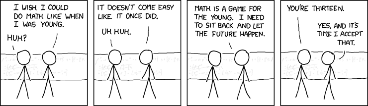
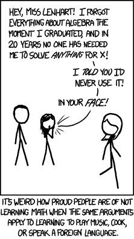

Among the most terrible human stereotypes, one stands apart:

— Math is not for me. Too hard. Math and I never got along, neither at school nor in life. I don't understand it and don't want to. And what is it even for? I studied algebra at school and I'm still waiting for it to come in handy.

Many of you have heard statements like this. And still hear them. And will hear them again more than once. At such moments I slowly take off my imaginary glasses, tilt my head slightly, and give the bridge of my nose a good rub. And I remember my own dreary story.

I went to an ordinary school with a slight emphasis on English. Math never particularly interested me or touched the strings of my soul. I treated it roughly the way an ordinary child treats religion: there's sort of a god, you have to go to church. Only here, there's sort of a subject, and you have to attend the lessons. This was all the more surprising since our homeroom teacher was the math teacher. True, he (she) went down in history as the owner of glasses with diamond lenses and titanium temples, because those glasses regularly flew across the classroom according to the laws of ballistics but never broke. I also didn't like geometry.

And so it would have stayed until the end of time, if one sunny day our beloved teacher, a.k.a. the homeroom teacher, hadn't fallen ill. The substitute was a young and lively woman, a top graduate of a teachers' college. At about the same time I got an F in geometry, which was untypical for me, even though I had tried very hard and solved almost everything on the test. That's when I started thinking, maybe for the first time in my life. "How can that be? Why? How did I get here and what am I doing here? What is my purpose?" I can't vouch for the last questions.

I decided something had to change, and decided to fall in love with math. A Shakespearean love story. Some time passed, and I fixed my grades. A lot of time passed, and I transferred to a school specializing in physics and mathematics. There the story repeated itself: F's again, but the busy evenings paid off, and in the end, within a year or a year and a half, I managed at least to move right up to the expected value, and even beyond.

The moral of the fable. I was and remain a person of absolutely average intellectual ability. I have been aware of this all my life. These words, in one form or another, will be on my tombstone. But that didn't stop me from falling in love with, as Gauss put it, the queen of the sciences, Her Majesty Mathematics. And not just falling in love, but learning to understand a little better the infinite beauty of Greek letters, generously seasoned with symbols from the UTF table. And I am firmly convinced that every one of the excuses above is utter bullshit. If you don't want to understand math, that's your problem, and it will die with you. And you, in turn, will be deprived of one of the greatest (and free) pleasures invented by human genius.

I'm not making this up, and I've already managed to name one of the scientists. Gauss was an outstanding mathematician. Legend has it that already as a schoolboy he astonished his teacher with a sudden insight. The teacher asked the pupils to add up a series of numbers against the clock:

$$1 + 2 + 3 + 4 + 5 + 6 + 7 + 8 + 9 + 10$$

All the children buried their noses in their sheets and began counting scrupulously. But Gauss blurted out the answer without thinking: 55! The teacher didn't believe it at first and suspected something was off. Gauss said in his defense that he had found the solution intuitively, with a formula! "What formula?"

$$\sum_{k=1}^{n} k = \frac{n(n+1)}{2}$$

$$1 + 2 + 3 + 4 + 5 + 6 + 7 + 8 + 9 + 10 = \frac{10 \cdot 11}{2} = 55$$

You don't need to be Gauss to derive the formula. Write out the original series, and under it the same series in reverse order. It's easy to see that each vertical pair sums to 11. And we add this number up 10 times. So the answer is "10 times 11", but don't forget to divide by 2, since we summed the same series twice:

$$1 + 2 + 3 + 4 + 5 + 6 + 7 + 8 + 9 + 10$$

$$10 + 9 + 8 + 7 + 6 + 5 + 4 + 3 + 2 + 1$$

A beautiful and accessible insight. Someone might recall Kozma Prutkov and his aphorism in their defense: *many things are incomprehensible to us not because our concepts are weak, but because these things do not enter the circle of our concepts*. If I were an intellectual and communicated exclusively in English, I would write in reply: **FUCK OFF**.

But I'm not like that. I understand that we live in hard times, and professions and vocations are usually chosen by chance. And it's silly to demand that an enthusiastic middle manager love math. Especially since he might give me a sullen look and ask importantly:

— And you, you louse, do you in turn love, say, painting?

I didn't pick painting out of thin air. There's simply the classic division into "physicists and lyricists" — the scientifically minded and the artistically minded. Some are closer to the first, some to the second. I have no problem with that. It's all fine. I just don't like it when people use it as a fence. Every person has two hemispheres of the brain, except Lenin of course, and no person has the cosmic right to use only one of them. So I answer:

— Yes, I adore painting. In all its diversity. And the abstract paintings of Jackson Pollock have a fractal dimension! In general, I love everything that has mastery, intelligence and style. And if I have time, I'll definitely get to know it better.

So there. Everything in the world is interconnected, and it so often turns out that if you look closely at a work of art, you can find the autograph of mathematics.

My favorite scientist is not Albert Einstein but Richard Feynman. Of course, he was a physicist, not a mathematician, but nowhere is math as useful as in physics. Even as a great physicist with all the honors, he never forgot that the world around us is always much more interesting and diverse than even the brain of a super-scientist can conceive. He has a wonderful book, a collection of stories from his life called [*Surely You're Joking, Mr. Feynman!*](http://lib.ru/ANEKDOTY/FEINMAN/feinman.txt_with-big-pictures.html). In it he jokes a lot, but sometimes he's serious, especially when he decided to learn to draw and started taking lessons. He says it was one of the most interesting experiments of his life — and he conducted a lot of experiments, believe me. Feynman took up painting not for fame but out of curiosity, yet fame found him here too, and his paintings began to be exhibited in galleries and even sold at auctions. All that time he hid his real status, so that had nothing to do with it.

Feynman set us a fine example. Always be ready to learn something new. He would have punched in the face any subhuman who dared to say:

— I'm twenty, I have a beard, and I'm still waiting for math to come in handy.

That statement hides a fence as tall as a skyscraper. That fence shuts off anyone who utters this spell, shuts them off from the chance to meet mathematics even once in their life. And really, how do you expect to find a use for it if you don't know it and, to put it mildly, don't love it? As the saying goes, no water flows under a lying stone. And I'll say even more: you can't even imagine how much you limit the range of your interests. Passionate people don't wake up thinking that today they must immediately take up hydrodynamics and get acquainted with the Navier–Stokes equations in differential form. They get there gradually, starting in their tender years with arithmetic and algebra and then progressively specializing their interest. The game gets more interesting as it gets harder.

You don't have to know math. The days when one could know all of mathematics are long gone. But reasonable interest, as far as I know, has never hurt anyone in this world. When you open any technical book, it is usually impossible to immediately grasp all the formulas and the ideas behind them. Almost every time it's terra incognita. And it takes a certain effort to extrapolate your limited stock of basic mathematical knowledge so that it assembles the puzzle and rewards you with a complete picture. But it's worth it, believe me.

Many great scientists have spoken on this subject. Take Roger Penrose. Another excellent physicist, winner of every possible prize, popularizer of science, author of many very worthy books. Do you notice the irony of fate? A post about mathematics and mathematicians, and somehow there are more physicists in it. But there is a deep truth in that, too. Anyway. Penrose has a monumental work called *The Road to Reality*. But here we're interested not so much in its contents as in its preface. Despite its limited length, he managed to express many wise thoughts in it. Penrose decided to break his usual practice of avoiding mathematical formulas and did use the language of mathematics, since without it it's simply impossible to understand what is really happening at the frontier of theoretical physics. Although Stephen Hawking, yet another physicist, ha-ha, had warned him that every mathematical formula in a book cuts the number of potential readers in half. He himself got away with only one formula in his popular book *A Brief History of Time*. Which formula? Why, "E equals m c squared", of course! Among other things, the preface contained these lines:

> Yet, when it comes to explaining things that are in principle accessible to understanding, I tend to consider myself an optimist. One might even say an incorrigible optimist. It seems to me that readers who cannot handle fractions are deceiving themselves a little — most of these people have the potential ability for this kind of activity, but for various reasons prefer "not to know" about it. No doubt there are also those among them who, looking at a line of mathematical symbols, even the simplest, see before them only the stern faces of parents and teachers who tried to drum "knowledge" into them and demanded parrot-like repetition in return, an appearance of understanding that needs no real understanding — you must learn from here to there, or else — while the magic and beauty of the subject is probably of no concern to anyone in such "teaching".

*(Penrose's words are translated from the Russian edition quoted in the original post.)*

The cosmos demands that I write one more thing. Lately there have been more and more attempts on the internet at a special kind of propaganda: that every person must be compelled to study programming, or, say, the art of writing. Hand on heart, I can tell you: I'm not a supporter of these ideas, and I'll definitely write a post about it, but later. Mathematics is a different matter. It is fundamental and all-encompassing. Everyone will find something of their own in it; the main thing is to start looking. It is as powerful a foundation for thinking as the gift of speech. And everyone learns to speak, as a rule, by the age of three. How is math any worse?

Amen.
