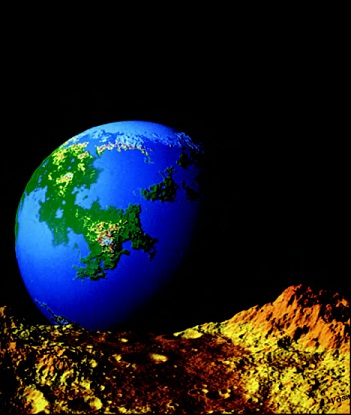

Wired.com recently published a [post](http://www.wired.com/wiredscience/2010/09/fractal-patterns-in-nature) called "Earth's Most Stunning Natural Fractal Patterns". In it the author collected breathtaking photographs of fractals that anyone can encounter in living nature. And just in my previous [post](http://iodiot.livejournal.com/39096.html) I lightly tried to blur the boundary between the living and the non-living, but now I realize those illustrations would have done the job a hundred times better.

Still, I can't help recalling Benoît Mandelbrot. I read his book, whose title is the same as this post's, about five years ago. Not much has stayed in my head, but I remember that Mandelbrot literally led the reader — me, in this case — by the hand along the road that led to the discovery of such an incredible mathematical object as the fractal. The road was rather winding: the well-known and revered Platonic solids refused to describe the world adequately. Of course, since antiquity nobody had tried to find, say, a perfect circle in nature, but as it turned out, the degree of *imperfection* had been badly underestimated. Everything pointed to the world being governed not by continuity but by self-similarity. And in 1875 a certain du Bois-Reymond added fuel to the fire by telling the world about a continuous nowhere-differentiable function constructed by Weierstrass.

Mandelbrot begins his book with the question "why is geometry often described as 'cold' and 'dry'?" And immediately answers: "One reason lies in its inability to describe the shape of a cloud, a mountain, a coastline, or a tree. Clouds are not spheres, mountains are not cones, coastlines are not circles, and bark is not smooth, nor does lightning travel in a straight line."

All this is what drove Mandelbrot to create a new, fractal geometry of nature. "I coined *fractal* from the Latin adjective *fractus*. The corresponding Latin verb *frangere* means 'to break': to create irregular fragments." Fractals are unique in that they have a fractional metric dimension, also called the [Hausdorff dimension](https://en.wikipedia.org/wiki/Hausdorff_dimension), which is defined in a special way. For example, the dimension of the [Koch curve](https://en.wikipedia.org/wiki/Koch_snowflake) can be computed from the construction procedure itself: each straight segment is divided into three equal parts, and the middle part is replaced by an equilateral triangle without its base. In other words, the original segment is replaced by *four* new ones, each *three* times shorter than the original. Taking the ratio of the logarithms of these two numbers gives $\ln 4 / \ln 3 \approx 1.26$. So the Hausdorff dimension of the Koch curve is 1.26. Simple.

Fractals are a favorite topic of many popular magazines. The standard template: a definition of fractals, their types, and along the way colorful illustrations of the most over-standard representatives: the Koch snowflake, the Hilbert–Peano curve and, of course, the Mandelbrot set. Sometimes one gets the feeling — and not only I — that a primer on fractals is a kind of scientific *lorem ipsum*, which, as we know, is widely used in layout mock-ups (to fill empty text space). Against this background, Mandelbrot's book only wins: it is genuinely interesting.

The fifth chapter of the book again begins with a question: "How long is the coast of Britain?" The question isn't idle. Such information is the alpha and omega of geography reference books. And land was and remains almost the most valuable resource a state owns. But you can't value and assess something you have no way of reliably measuring. Mandelbrot suggests considering a stretch of some coastline. "It is evident that its length is at least equal to the distance measured along a straight line between its beginning and its end. However, the typical coastline is irregular and winding, and there is no question it is much longer than the straight line between its end points."

Indeed, it's clear even without great minds that the problem is far from trivial. You can take up Mandelbrot's challenge and try to estimate the length of Great Britain's coastline using Google Maps. To do this, [open](http://maps.google.com/maps?ll=53.826,-2.422&spn=0.3,0.3&t=h&q=53.826,-2.422) a map of the island and move the zoom slider a third of the way from the minus. At this zoom level the asymmetry in ruggedness between the eastern and western parts is clearly visible. For the east coast a walking step of 0.5 centimeters would be quite reasonable, while the western part requires a finer approach, i.e. a finer step. But if you move the slider another third, the ruggedness simultaneously evens out and increases: a multitude of new small details comes into view. That's how it is. It turns out that at each level we can choose a rational step, but as we zoom in, more and more new notches, bends and twists appear. "Whichever method is used, the result is always the same: the typical coastline length is very large and so ill determined that it is best considered infinite."

Mandelbrot is right on the one hand and clearly overdid it on the other. You can of course consider the length of a coastline infinite, but that is utterly useless and has no practical value. And is it really infinite? It seems not. After all, once you reach the level of the crystal lattice, there's nowhere further to go. You can stop at that level, take a suitable measuring tool and begin the painstaking count. The value will most likely turn out astronomical, but certainly not infinite.

So, in general, the length of a coastline is a function of the step, and its value increases monotonically as the argument decreases. "Consequently, anyone who wishes to compare different coastlines from the viewpoint of their 'length' must find a replacement for the notion of length, which is inapplicable to this case." As a way out, geography reference books could list, together with lengths, the step values used as the basis for the measurements. But such an approach would surely introduce confusion and chaos. Different publications would certainly use different step values, which sooner or later would lead to a cognitive catastrophe — if only because there is no method for converting a length measured with step *x* into a length measured with step *y*.

"Richardson gives this example: Spanish and Portuguese encyclopedias give different lengths for the land border between the two countries, the difference being 20% (the same is true of the border between Belgium and the Netherlands). This discrepancy must be partly due to a different choice of *ε* [the step]. Empirical evidence shows that for such a difference to arise it suffices for one value of *ε* to be only twice the other; moreover, it is not surprising that a small country (Portugal) measures its borders more carefully than its big neighbor."

Further on in his book Mandelbrot arrives at a remarkable conclusion: a coastline is a *non-rectifiable* curve — a curve whose length does not tend to any definite limit as the step decreases. Euclidean curves, in turn, are rectifiable: for example, you can approximate a circle with a polygon long and tediously, but the total length of the sides will still end up equal to $2\pi r$. Mandelbrot proposes calling coastlines and curves like them *fractal curves*. Obviously, their dimension is greater than 1 and fractional.

*(Quotations from Mandelbrot are translated from the Russian edition used in the original post.)*

That's the story. It stuck with me and I liked it more than the others. But you can't, you simply can't write about Mandelbrot without writing about his namesake fractal. The Mandelbrot set, in my opinion, should have become one of the scientific symbols of the 20th century, alongside the DNA double helix and the photograph of the Earth from the surface of the Moon. In any case, it is an example of striking mathematical self-sufficiency and beauty. Plato in his time discovered solids that exist independently of the physical world and named them after himself. But compared to Mandelbrot, his discovery is negligible.

In *The Emperor's New Mind*, Penrose invited us on a journey to a wondrous world called Tor'Bled-Nam. He put the reader on a ship with a powerful telemetric camera. First it picked out of space a contrasting blot with jagged rays radiating from it in all directions. As the camera zoomed in, the blot's boundary began to acquire new details, and the rays turned into colorful worlds… Many years have passed since then, and the ship no doubt keeps diving into the depths of that bizarre world, its passengers finding more and more new details around every bend. Of course, you've guessed what gave the world its name. If not, remember Stephen King, his novel *The Shining* and *REDRUM*.

The very existence of the Mandelbrot set prompts interesting reflections if you try to imagine it as a universe like ours, with its own history. A whole multitude of analogies arise. According to cosmological ideas, the observable universe can be considered a thing-in-itself as well — a quantum fluctuation whose lifetime is inversely proportional to its energy. The Big Bang gave birth to space-time, gave matter its momentum, and for 13.7 billion years now matter has uniformly filled the surface of a sphere that is relentlessly expanding. In turn, everything most interesting in the universe of the Mandelbrot set is also located on the boundary of a circle. If you start zooming into our universe, you'd have to travel at least from galaxies down to subatomic particles. People haven't yet named the structures in the Mandelbrot set, but nothing and nobody forbids us to call the first protuberances, say, galaxies, dive into them, discover their stars, and around them planets with their own fractal inhabitants. The only significant difference: the world of the fractal is infinite in depth — but does the depth of our world end with quarks, which nobody suspected even at the beginning of the last century? Scientists have long been raving about a theory of everything, a formula that would describe the interactions of all known particles. In the universe of the Mandelbrot set, the theory of everything is well known and extremely concise: $z \mapsto z^2 + c$.

I started this post with a link to a collection of living fractals. But now they no longer seem so unique to me. During my brief wanderings in Google Maps I came across myriads of fractal images: turbulence in coastal zones, winding river channels, scatterings of rocks… A few hours are enough to create your own gallery of living and not-so-living fractals. And it seems to me that in the future fractal geometry will make it possible to solve one extremely important problem that I raised in my previous post.
