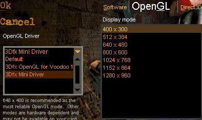
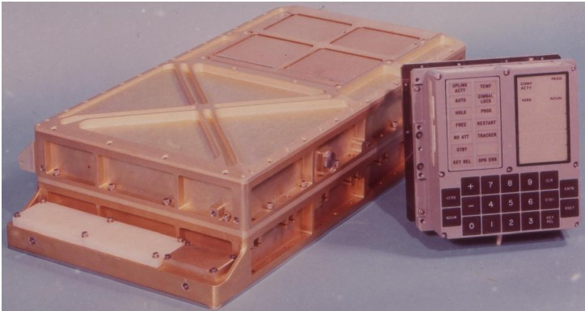

A bit of history. In the mid-90s several graphics cards appeared on the market that could do no more and no less than 3D rasterization. The most popular card at the time was, of course, the Voodoo Graphics from 3Dfx Interactive. I still remember playing Half-Life 1 for the first time in a computer club: the graphics were simply stunning, and being able to pick something other than "Software renderer" in the options warmed my heart. Glorious times. Later I got that card too, but the feelings of childhood could no longer be brought back: the card kept freezing, refused to work with 90% of games, threw software exceptions and generously seasoned the hard-won picture with artifacts.

Of course, by modern standards this card's capabilities were very limited. No shaders, no vertex transformations. The CPU did all the work and then fed the graphics card the coordinates of triangles to rasterize. A pixel shader cast in silicon, so to speak. Along with a vertex coordinate you could also pass a texture coordinate and an RGBA color. The texture coordinate was used to access the single texture (surprise!), and the interpolated color could be combined with the value fetched from the texture using a limited set of operations. An alpha channel was supported too. Leaving out a few other details, that fully exhausted the capabilities of the Voodoo Graphics. None of this could compare with sophisticated software renderers, but in terms of raw power the Voodoo Graphics was simply a monster. The computing revolution also had its downsides: in particular, most 3D games of that era were hard to tell apart graphically.

Modern GPUs have leapt far ahead. Next to them the archaic Voodoo Graphics looks like a wood-fired steam engine; nevertheless, the continuity of approach has survived: rasterize as many triangles per unit of time as possible. But where the rasterization process used to be either impossible to control at all, or controllable only through a limited set of calls like *glLight*, now we have shaders, and that's wonderful. For those living under a rock: shaders are programs written in a special language (for example, GLSL or HLSL) that run on shader processors. It's the shader processors I wanted to talk about.

As kids we all dreamed of supercomputers: huge mainframes gathering dust in underground military bunkers, blinking their lights in weary anticipation. It's widely known that if you feed such a supercomputer the coordinates and momenta of every particle in the universe, it will gladly compute the next state of the universe in the blink of an eye, provided that *dt* tends to zero. Probably. In theory. Childhood is over, and the dreams have come true. Any modern PC is a supercomputer in miniature — mainly not thanks to multi-core CPUs armed with gigabytes of RAM, but thanks to graphics cards. Prometheus stole the GPU from the gods and gave it to humans.

The GPU is a synonym for raw power. The number of processors runs into the hundreds, the megahertz are off the charts, the bandwidth… is there. Sure, these shader processors aren't as "smart" as Intel's CPUs, but when it comes to gigaflops, nothing else is needed.

My close acquaintance with GPUs began about a year ago. Back then I had no idea how much more exciting programming can be when you have enormous computing power at your fingertips. But everything has its price — if only because an ordinary C/C++ program will most likely refuse to run on a shader processor. And in general, the GPU programming paradigm has little in common with everything we have to code day to day.

It's important to note here that using the GPU for its intended purpose, i.e. rasterizing huge numbers of triangles, is usually not very interesting — unless, of course, you're writing yet another CryENGINE killer. There are always exceptions, but mostly it's a thankless job in which the "wow effect / amount of code" ratio tends to zero. That's how I got acquainted with such diverse areas of human activity as ray tracing, volume rendering, fluid/smoke simulation, and rendering based on distance functions, including everyone's beloved fractals — three-dimensional ones this time. But I'll write about that some other time. Definitely. Probably.

I've used the adjective "enormous" with the noun "power" many times. It's time to put it all in concrete numbers. For a reference we can take… that's right, the computer that sent a man to the Moon, namely the Apollo Guidance Computer (AGC).

There's a myth that the processor of any modern pocket calculator is more powerful than the AGC. Maybe it's not a myth. The AGC had 2 kilobytes of RAM, 32 kilobytes of read-only memory, 4 general-purpose registers and a processor clocked at 4.077 MHz (or 0.004077 GHz). Assuming this processor executed one instruction per clock cycle, its computing power was:

$$P_{\text{AGC}} = 1 \times 0.004077\ \text{GHz} = 0.004077\ \text{GFLOPS}$$

Not much, it seems. My home computer has a not-so-fresh NVIDIA GeForce 9800 GT graphics card. At [this](http://en.wikipedia.org/wiki/GeForce_9_Series) link you can find that the power of this card is:

$$P_{\text{GPU}} = 504\ \text{GFLOPS}$$

That seems like a lot. It's interesting to find the ratio between these two:

$$\frac{P_{\text{GPU}}}{P_{\text{AGC}}} = \frac{504\ \text{GFLOPS}}{0.004077\ \text{GFLOPS}} \approx 123\,620$$

A net gain of one hundred twenty-three thousand six hundred twenty times. Not bad. If the old AGC sent a man to the Moon, the new GPU could send him 3.3 times farther [than](http://www.wolframalpha.com/input/?i=123620+*+%28distance+between+moon+and+earth%29) the current distance from the Sun to the Voyager probe. For reference, Voyager is the most distant human-made object. And, also for reference, light covers that distance in two days.

Of course, comparing 1960s technology with the technology of our era isn't quite sporting or quite legitimate. So let's go back to my home computer, which has an Intel Core 2 Duo E4000 CPU. On [this](http://www.intel.com/support/processors/sb/CS-032819.htm) site you can look up the computing power of Intel's whole processor line-up, and for my processor it is:

$$P_{\text{CPU}} = 14.4\ \text{GFLOPS}$$

$$\frac{P_{\text{GPU}}}{P_{\text{CPU}}} = \frac{504\ \text{GFLOPS}}{14.4\ \text{GFLOPS}} = 35$$

Now the gain isn't so huge: only 35 times. Though it's not all that simple here. These gigaflops are calculated on the basis of double-precision numbers and so-called MAD (multiply-add) instructions, where two arithmetic operations are performed per clock cycle.

From a practical point of view, this means that all sorts of interesting renderers (and not only renderers) can run in real time (60 frames per second) on the GPU and can't on the CPU. From the point of view of pure enjoyment and wow effect, this is very important. I'll write about specific applications in full detail in future posts; for now, a video. Meet the three-dimensional Sierpinski fractal.

[Volumetric Sierpinski](http://vimeo.com/47474975) from [Ignat Grob](http://vimeo.com/user12948672) on [Vimeo](http://vimeo.com).
