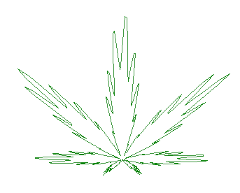

I am not, in principle, a fan of this — undoubtedly remarkable — plant. But… a thing like this is very easy to draw. All it takes is switching to polar coordinates and plotting the following curve:

$$r(a) = (1 + \sin a)\,(1 + 0.9\cos 8a)\,(1 + 0.1\cos 24a)\,(4 - \sin 80a)$$

