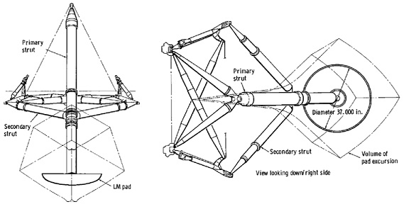

Yesterday morning I had the misfortune to stumble upon a film of the deepest stupidity and idiocy, meant to debunk all of modern science and — as you may have guessed — to prove the power of the biblical approach to describing the world. I don't understand and can't understand how people can spend so much energy directing such spectacles. The format is time-tested: a cohort of sensational claims is dumped on the viewer one after another, claims that modern *atheist* science supposedly can't or won't explain. At the end comes the conclusion that science is pseudoscientific and serves only to justify the nonsense dreamed up by so-called scientists, atheists.

I don't want to link to this film. My goal is much more modest: to examine one claim from it here. I don't take it as a challenge. It rather reminds me of the [infinite monkey theorem](https://en.wikipedia.org/wiki/Infinite_monkey_theorem). If you remember: hitting the keys of a typewriter completely at random, a hypothetical monkey will sooner or later type one of Shakespeare's plays. Only in our case, what was randomly generated is the following sensation; an exact transcript follows:

*In the 1950s scientists tried to calculate how much dust there is on the Moon. And they calculated that every 10,000 years a 2 cm layer of dust accumulates on the Moon. And they thought it would be impossible to land on the Moon: the ship would sink in the dust. So huge landing pads with wide feet were built to distribute the weight evenly. Even the ladder was shortened by 30 cm; they expected there would be a lot of dust on the Moon and the astronauts would sink in it, but when the astronauts landed they found that there is just over one centimeter of dust on the Moon, and if the Earth is billions of years old, then where is all the dust?*

I picked this sensation because it can't be answered off the cuff — it takes at least some research. But let's go step by step.

Some of the questions can be answered by the book ["Apollo 11 Preliminary Science Report"](http://books.google.com/books?id=vVzxAAAAMAAJ). It contains the official scientific report on the Apollo 11 mission, during which humans first landed on the Moon.

On page 85 you can read that before 1969 the following sources of information about the properties of the lunar surface existed: visual observations from Earth, thermal measurements, photographs of the Moon taken during the Ranger program, direct data from the landings of the Soviet probes Luna 9 and Luna 13, as well as five American probes of the Surveyor program.

It was thanks to the last of these programs that a satisfactory model of the lunar surface was built. The key points: the lunar soil is nearly incompressible, slightly cohesive, and consists of particles ranging in size from silt to fine sand. The soil behaves roughly like terrestrial soil with a density of 1.5 grams per cubic centimeter. Its strength (bearing capacity) increases at a depth of a few inches (five centimeters or more).

Various calculations were made based on this model. For example, the footpads of the lander's legs were expected to sink 10–15 centimeters into the soil. A diagram of a landing leg with its footpad is below:

Page 100 describes the landing. The lander's small vertical velocity led to less penetration of the footpads into the lunar soil. In the conversations between mission control and Armstrong and Aldrin, it was established that the footpads sank 3–8 centimeters. So everything happened according to the calculations, the scientists were not surprised, and the layer of dust on the Moon turned out to be more than one centimeter thick.

Moving on. In the book ["Lunar Sourcebook: A User's Guide to the Moon"](http://books.google.com/books?id=7Q49AAAAIAAJ) you can read about the general characteristics of the lunar surface. Page 285: all studies show that the lunar surface consists entirely of regolith, which completely covers the underlying bedrock except for steep-walled craters and lava channels.

Further. The thickness of the regolith rarely exceeds 10–20 meters. During the Apollo missions astronauts drilled to depths of up to 3 meters and, based on grain-size analysis, concluded that the maximum depth does not exceed 20 meters, at least at those sites. Today the regolith is generally considered to be 4–5 meters thick in the maria (the conventional name for the dark areas of the lunar surface), and can average 10–15 meters in the old highland regions.

So everything falls into place. The Moon is covered with a thick layer of regolith whose thickness varies widely, which means that the history of the Moon — and, consequently, of the Earth — spans more than tens of thousands of years. It looks like modern science is saved.

PS: For connoisseurs, I can still send the link to this degenerate video privately.
