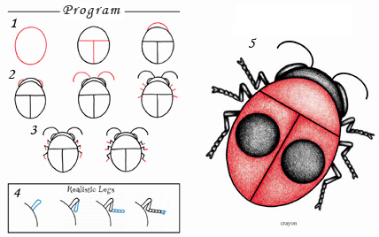

Everyone knows that writing software is a very complex and multifaceted process, which usually leads to lots of bugs in the code and, as a consequence, in the application itself. Thank Zeus, there are colored pencils, and all stages of development can be illustrated with a small diagram that will help newcomers (i.e. me) better picture this mystical process:

So, stage by stage:

1. The hardest one. Designing the overall architecture of the application. At this stage you usually draw just a big oval with no limbs; then the oval is divided into regions (classes), and relationships between them are established.
2. Starting to write code. The oval gets eyes and antennae (interaction with the operating system API), and the first implementations of the class methods appear — the legs.
3. Iterative development. The initial method implementations are improved and reshaped; the legs grow longer.
4. The legs (methods) take their final shape. If all is well, go to step 5; otherwise, back to step 3.
5. Draw the interface (circles on the belly), color the GUI (different colors), add skin support. The ~~bug~~ program is ready!

The original image probably looks [like this](http://www.charlesbridge.com/productdetails.cfm?PC=4414).
