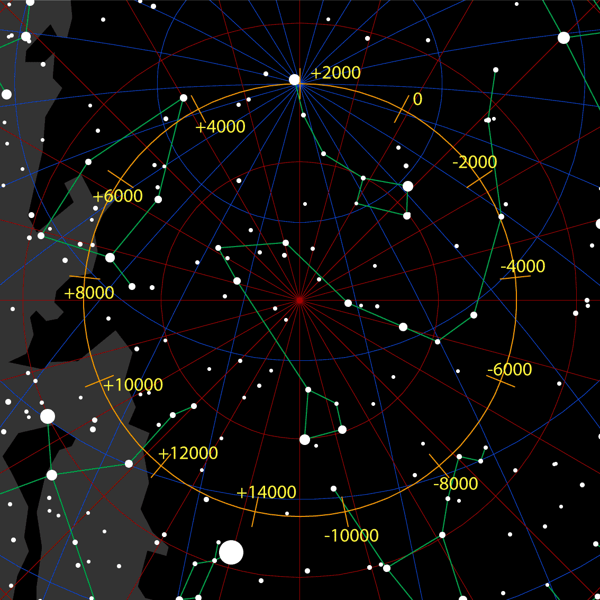

Yes, as everyone knows, there are 10 types of people: those who understand binary and those who don't. If you belong to the first category, you probably guessed right away that converting to our native decimal gives the "sacred" number "2012". I did it on purpose, of course, because that date and everything connected with it has long since become the gold standard of obscurantism.

As everyone already knows, the ancient Maya civilization had a special calendar according to which a certain era is to end in 2012 and, accordingly, a new one is to begin. Nothing special, it would seem, but the change of eras is bound to bring something [terrible and great](http://en.wikipedia.org/wiki/2012_phenomenon). That something already covers hundreds of different hypotheses: the Earth colliding with the mysterious planet Nibiru; people transitioning into the fifth, sixth, seventh dimensions; a flip of the magnetic field; the Solar System passing by a supermassive black hole or through the galactic plane; earthlings meeting an alien civilization (necessarily a higher one); plus all sorts of small stuff like planetary parades and solar activity. You really have to be good at it to make a mountain out of a molehill like that. It's especially delightful when Christians join the scary predictions with their various versions of Judgment Day — the Maya were pagans, one would think…

Actually, I already touched on 2012 in my [previous](http://iodiot.livejournal.com/40057.html) post. There I quoted an article about "quantum leaps". In the best traditions of the genre it also featured the "sacred" year and various great eras with aliens. The great era there lasted 26,000 years. That figure seemed quite familiar to me, which is surprising overall given the rest of the nonsense. I thought back then that this was probably the very number from the Maya calendars. But I was wrong. According to the Maya, it's actually a great cycle 5,126 years long that is about to end.

So why did 26,000 years seem familiar? Only because the full cycle of the Earth's precession is about 25,765 years. Nothing more than a simple coincidence, and of course I'm not going to build conspiracy theories on it. [Precession](https://en.wikipedia.org/wiki/Axial_precession) is an interesting physical phenomenon that arises in a rotating system.

Everyone played with a spinning top as a kid and remembers how, after a while, its rotation axis would tilt away from the vertical and start moving along a widening spiral. Gravity in this case creates unbalanced torques applied to different points of the top. The Earth, like a top, rotates around its axis; it is acted on by the Moon's gravity, and so its axis also precesses over time. An interesting consequence is that [Polaris](http://www.wolframalpha.com/input/?i=Polaris+star) holds the status of the north celestial pole only temporarily, and at some point the axis will clearly point to another spot in the starry sky — but don't despair: everything will come back full circle in a mere 25,765 years. By the way, in ancient Egyptian times the celestial pole was near the star Thuban (α Draconis)!

**The wanderings of the north celestial pole** ([source](http://upload.wikimedia.org/wikipedia/commons/1/16/Precession_N.gif))

A more tangible consequence concerns the climate. As we know, the seasons change because the Earth's axis is tilted by 23.5°: if it's summer in our northern hemisphere, the hemisphere is tilted toward the Sun at that moment; in winter, the opposite. The axis itself doesn't tilt anywhere, of course — the Earth simply moves along its orbit, and the orientation of its axis relative to the Sun changes. The ellipticity of the orbit affects the climate only partly: winter and summer in the northern hemisphere are milder because at those times the Earth is at perihelion and aphelion, respectively. Precession, meanwhile, changes the orientation of the Earth's axis slowly but surely. In about 13,000 years the seasons will inevitably shift so that winter becomes summer. And this is not a cheap hypothesis for the tabloids but an inevitable consequence of Newton's laws. The same goes for ice ages; this is written about, for example, [here](http://elementy.ru/trefil/21168): "because of periodic changes in the parameters of its orbit, the Earth goes through recurring ice ages."

That, by and large, is all the magic of a physical quantity like 26,000 years — or, to be precise, 25,765 years. What surprises me most in all this is how frantically many people adore cheap sensations with absurd premises and conclusions, while the real world holds far more amazing and interesting things for them.
