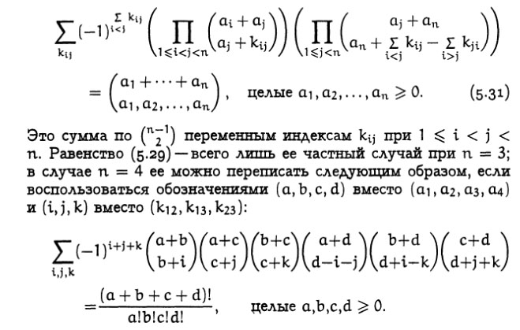

Конечно, я люблю **Кнута** и его прекрасные книги. У многих они аккуратно пылятся на полках и служат отличными подставками подо что угодно. Но есть у меня ещё одна драгоценная книга, не такая известная, как остальные, и называется она – **Конкретная математика.**Об этом манускрипте я когда-нибудь обязательно напишу поподробней.А в этот раз просто выложу кусок страницы со славной формул-кой, которая так "органично" возникла где-то на 198 странице. Попробуй это запомнить и разобрать на кирпичики...

P.S.: Пришлось просто перевернуть страницу, увы...
