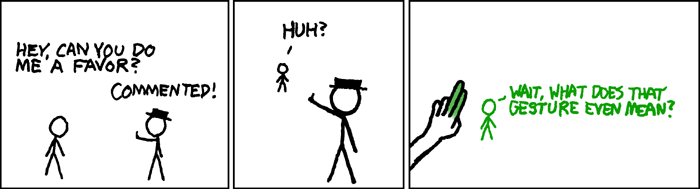

Итак, комментарии в исходных кодах! Они не важны для компилятора, но важны для живого человека: служат ему путеводной нитью по витиеватому миру операторов, функций и классов. Код, богато усеянный комментариями, светится ясностью и разумностью, и существует мнение, что комментариев много не бывает. Или бывает? В этом небезынтересно разобраться.

Стоит отметить, что все выше- и нижесказанное не претендует на какую-либо научную новизну. По поводу комментариев написаны десятки прекрасных эссе, блогопостов, сообщений на форумах и даже книжных глав. По поводу комментариев высказывались практически все известные программисты. И даже я, если мне не изменяет память, уже как-то писал на эту тему, хотя все мои сто миллиардов нейронов отказываются вспоминать об этом.

Любое серьезное исследование должно начинаться с экскурса в историю. Безусловно, самый известный комментарий был оставлен Пьером Ферма на полях «Арифметики» Диофанта:\
> Наоборот, невозможно разложить ни куб на два куба, ни биквадрат на два биквадрата, и, вообще, никакую степень, большую квадрата на две степени с тем же показателем. Я открыл этому поистине чудесное доказательство, но эти поля для него слишком малы.

Ферма как в воду глядел, и для решающего доказательства зубодробительной теоремы Эндрю Уайлсу понадобилось полжизни и несколько томов математических выкладок.

Но вернемся к первоначальному вопросу. Бывает ли комментариев много? Можно ли переусердствовать в этом благородном занятии? Конечно:

```csharp
// This method takes two integer values and adds them together via the built-in
// .NET functionality. It would be possible to code the arithmetic function
// by hand, but since .NET provides it, that would be a waste of time
private int Add(int i, int j) // i is the first value, j is the second value
{
    // this statement performs the add functionality using the + operator on the two
    // parameter values, and then returns the result to the calling function
    return i + j;
}
```

Это хоть и крайний случай, но достаточно распространённый. Комментарии перестают выполнять свою роль, когда их объем сопоставим с объемом кода. Они сообщают ровным счетом ничего нового, и лишь захламляют ограниченное информационное пространство в один экран. Легко впасть в другую крайность и написать магический код, в котором нет ни единого художественного оборота, но содержится окончательный [ответ на главный вопрос жизни, вселенной и всего такого](http://ru.wikipedia.org/wiki/Ответ_на_главный_вопрос_жизни,_вселенной_и_всего_такого):

```c
next = next * 1103515245 + 12345;
unsigned int r = ((unsigned int)(next / 65536) % 32768);
printf("r = %u\n", r);
```

В этом коде все прекрасно, кроме того что малопонятно что он делает. Одинокий комментарий спасает положение:

```c
// calculate next pseudorandom number
next = next * 1103515245 + 12345;
unsigned int r = ((unsigned int)(next / 65536) % 32768);
printf("r = %u\n", r);
```

Возникает мимолетное ощущение, что цель достигнута. Несколько строк неочевидного кода справлены комментарием, который всецело проясняет ситуацию. Можно ли желать большего? Можно:

```c
unsinged int random()
{
  next = next * 1103515245 + 12345;
  return ((unsigned int)(next / 65536) % 32768);
}

printf("r = %u\n", random());
```

Оказывается, **лучший комментарий — это его отсутствие**, потому что сам код и является идеальным комментарием, по крайней мере, хороший код. Каждый раз, когда возникает похабное желание написать комментарий — верный признак того, что здесь нужен рефакторинг. В моей голове давно выкристаллизовалось эмпирическое правило: *количество слов в отдельно взятом комментарии пропорционально вероятности его удаления в обозримом будущем*. Как говорит один мой друг: «поверь мне». Но не стоит забывать, что любые обобщения опасны, и даже… ну вы знаете.

Все это отлично согласуется с классическим анекдотом про программистов, в котором Шерлок Холмс и его коллега Ватсон, пролетая на воздушном шаре, спросили у одинокого козопаса, где они находятся. «На воздушном шаре, сэр». Холмс заключил, что ответчик был программистом, потому что тот во-первых дал абсолютно точный ответ, а во-вторых — абсолютно бесполезный. Эти же эмоции я испытываю, когда вижу нечто подобное:

```c
// increment value by one
i++;
```

Для тех, кто читает эти строки, английский язык скорей всего не является родным. Это вносит дополнительные проблемы. Одно дело совладать с ключевыми словами и писать лаконичные программы, другое — формировать разумные комментарии на родном языке английской королевы. Часто так бывает, что думаешь на русском, составляешь в голове утверждение, которое точно описывает суть дел, но трудности перевода вносят свои коррективы, и в итоге шикарное утверждение превращается в тавтологию. Самодокументированный код опять решает, поскольку позволяет свести количество комментариев к минимуму, но это, конечно же, не отменяет проблему именования переменных, функций, классов и других структурных единиц.



Комментарии, как и все другие очевидные и удобные вещи, должен был кто-то изобрести и придумать. Мне было интересно, помнит ли история первый комментарий в исходных кодах. Я попытался найти материалы, но ничего не вышло. Скорей всего первенство всегда можно будет оспорить, и сам вопрос не имеет особого смысла. Но никто, наверное, не будет спорить, что золотая эпоха комментариев пришлась на годы безраздельного властвования ассемблера. Ведь воспринимать безразмерные простыни однообразного кода без человеческих ремарок было просто невозможно.

Ситуация кардинально улучшилась с появлением С-подобных языков. С тех самых пор код стал больше походить на удобоваримый рассказ, а не на шифровку рукописей Майя посредством шифровальной машинки Энигма. Соответственно роль комментариев также уменьшилась, так как программисты обзавелись новыми и мощными выразительными средствами. Появление объектно-ориентированных языков лишь закрепило тенденцию.

Последние рассуждения я привел в поддержку мысли, что современные языки, как правило, предоставляют достаточно выразительных средств, чтобы писать понятный код без привычных комментариев. Остается лишь одно: использовать эти средства и делать мир лучше. Есть хороший совет: писать код так как будто его будет читать серийный маньяк-убийца. Может так статься, что именно неуместный комментарий станет последней каплей.

Тем, кто испытывает к комментариям нежные чувства, могу посоветовать посетить следующее обсуждение: [“What is the best comment in source code you have ever encountered?”](http://stackoverflow.com/questions/184618/what-is-the-best-comment-in-source-code-you-have-ever-encountered). Там же я подчерпнул название для поста, оттуда же я взял и следующую цитату:

```c
//
// Dear maintainer:
//
// Once you are done trying to 'optimize' this routine,
// and have realized what a terrible mistake that was,
// please increment the following counter as a warning
// to the next guy:
//
// total_hours_wasted_here = 42
//
```
