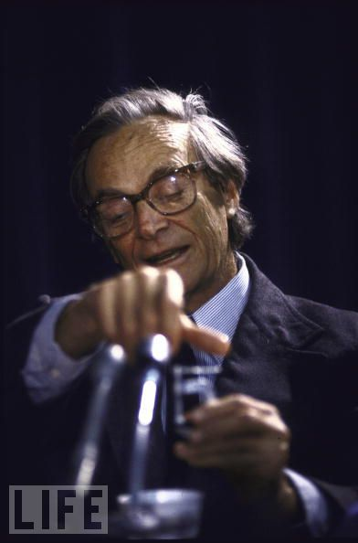

Когда меня просят посоветовать почитать что-то одновременно веселое и научное, то я, конечно же, рекомендую книгу [«Вы, конечно, шутите мистер Фейнман»](http://en.wikipedia.org/wiki/Surely_You%27re_Joking,_Mr._Feynman!). Как оказалось, у Фейнмана есть ещё и другая менее популярная книга — [«Какое тебе дело до того, что думают другие?»](http://en.wikipedia.org/wiki/What_Do_You_Care_What_Other_People_Think%3F). Книгу условно можно разбить на две части: веселые забористые истории и одна большая история про то, как Фейнман в составе президентской комиссии расследовал причины крушения шаттла «Челленджер», который взорвался на 73-й секунде полета. С одной стороны странное соседство, но катастрофа случилась в 1986 году, а Фейнман умер в 1988 году, и скорей всего книга просто является посмертной компиляцией его дневников.

Первую часть я пропустил, дабы быстрее проглотить разборки с шаттлом. Не волнуйтесь, я не собираюсь пересказывать содержание, хотел лишь написать о паре забавных и интересных моментов.

Сегодня о причинах катастрофы известно примерно [следующее](http://ru.wikipedia.org/wiki/%D0%9A%D0%B0%D1%82%D0%B0%D1%81%D1%82%D1%80%D0%BE%D1%84%D0%B0_%D1%88%D0%B0%D1%82%D1%82%D0%BB%D0%B0_%D0%A7%D0%B5%D0%BB%D0%BB%D0%B5%D0%BD%D0%B4%D0%B6%D0%B5%D1%80): разрушение летательного аппарата было вызвано повреждением уплотнительного кольца правого твердотопливного ускорителя при старте, что впоследствии привело к разрыву швов ускорителя.

Когда Фейнман начинал вникать в суть дела, то, конечно же, ни о чем таком он не догадывался. Лишь после многочисленных просмотров фотографий и видеозаписей полета шаттла стало понятно, что возгорание возникло в одном из участков ракетоносителя.

Однако у Граэма оказалось несколько интересных фотографий. На них было видно пламя, появляющееся из первого твердотопливного ракетоносителя за несколько секунд до взрыва. Было сложно точно определить, откуда выходит пламя, но в офисе Граэма была модель шаттла. Я поставил модель на пол и стал ходить вокруг нее, пока не нашел место, откуда она выглядела абсолютно идентично фотографии: как по размеру, так и по расположению.

В то же время Фейнману позвонил генерал Кутина и практически вручил ключ к проблеме.

Потом он говорит: «Сегодня утром я возился с карбюратором своей машины и подумал: шаттл оторвался от земли, когда температура равнялась 28 или 29 градусам. Самая холодная температура до этого полета была 53 градуса. Вы — профессор; *каким образом, сэр, холод влияет на кольца**?*»

— О! — сказал я. — Из-за холода кольца становятся жесткими. Да, безусловно!

Ученому только и оставалось, что выяснить, как на самом деле ведет себя уплотнительное кольцо при низких температурах. Для этого он добыл окольными путями реальный образец резины, в скобяной лавке купил зажим и плоскогубцы, и со всем этим последовал на официальное большое заседание. Для эксперимента лишь не хватало стакана воды со льдом, которая обычна всегда была в избытке на подобных мероприятиях, всегда, но не на этот раз. Фейнман долго просил принести ему холодной воды и в конце концов это произошло.

Наконец, мистер Маллой доходит до этого места, я нажимаю кнопочку своего микрофона и говорю: «Я достал эту резину из модели, поместил в зажим и на некоторое время опустил в воду со льдом».

Я достаю зажим из стакана, поднимаю его вверх и разжимаю со словами: «Я обнаружил, что при раскрытии зажима резина не принимает прежнюю форму. Другими словами, в течение более чем нескольких секунд этот материал не обладает эластичностью, когда находится при температуре в 32 градуса. Я полагаю, что это имеет некоторое значение для нашей проблемы».

Вот так вот. Если разобраться, то это был один из самых известных научных экспериментов, благодаря тому, что катастрофа была у всех на устах и люди пристально следили за каждой вехой в деле. Одна из фотографий запечатлела тот яркий момент.

Ещё я не мог пройти мимо интересных наблюдений Фейнмана по поводу компьютеров и программ, под управлением которых летал в те времена шаттл.

Самим шаттлом управляет, главным образом, компьютер. Как только он включается и начинает работать, то внутри больше никто ничего не делает, потому что возникает огромное ускорение. Когда шаттл достигает определенной высоты, компьютеры на некоторое время немного снижают осевую нагрузку двигателя, а по мере увеличения разрежения воздуха снова ее поднимают. Примерно через минуту после этого отпадают два твердотопливных ракетоносителя; еще через несколько минут отпадает основной топливный резервуар, причем все операции контролируются компьютерами. Шаттл автоматически попадает на орбиту — астронавты просто сидят на своих местах.

У компьютеров шаттла не хватает памяти, чтобы хранить все программы до конца полета. После попадания шаттла на орбиту астронавты вынимают некоторые кассеты и загружают программу для следующей фазы полета — всего этих фаз шесть. Ближе к концу полета астронавты загружают программу возвращения на Землю.

На борту шаттла четыре компьютера, обрабатывающих одни и те же программы. Обыкновенно все четыре компьютера работают абсолютно согласованно. Если один компьютер выходит из согласования, то полет все равно может продолжаться. Но если согласованно работают только два компьютера, полет необходимо прекратить, и шаттл должен немедленно вернуться на Землю.

Для большей безопасности на борту есть еще и пятый компьютер, расположенный отдельно от четырех предыдущих, с проводами идущими по другим каналам. В этот компьютер заложено всего две программы: программа подъема и программа спуска (У него едва хватает памяти на размещение двух этих программ). Если что-то произойдет с остальными компьютерами, то этот пятый компьютер сможет вернуть шаттл на Землю. Его никогда нельзя использовать ни для чего другого.

Но наиболее эффектная вещь — это посадка. Как только астронавты узнают, где они должны приземлиться, они нажимают одну из трех кнопок — обозначенных как Эдварде, Уайт Сэндс и Кеннеди, — благодаря чему компьютер узнает, где приземлится шаттл. Затем несколько маленьких ракет его немного замедляют и вводят в атмосферу под почти прямым углом. Это опасная часть, во время которой нагревается все покрытие.

В течение этого времени астронавты ничего не видят, и все изменяется настолько быстро, что снижение должно проводиться автоматически. На высоте около 35 000 футов шаттл замедляется до скорости, не превышающей скорость звука, и тогда им можно управлять вручную, если возникнет такая необходимость. На высоте же в 4000 футов происходит нечто, что выполняет не компьютер: пилот нажимает на кнопку, чтобы опустить шасси. Я нашел это очень странным — глупость, которая, очевидно, связана с психологией пилотов: они герои в глазах публики; все считают, что именно они управляют шаттлом, тогда как истина в том, что им не нужно ничего делать до того момента, когда они нажимают кнопку, чтобы опустить шасси. Для них просто невыносима мысль, что, на самом деле, им делать нечего.
