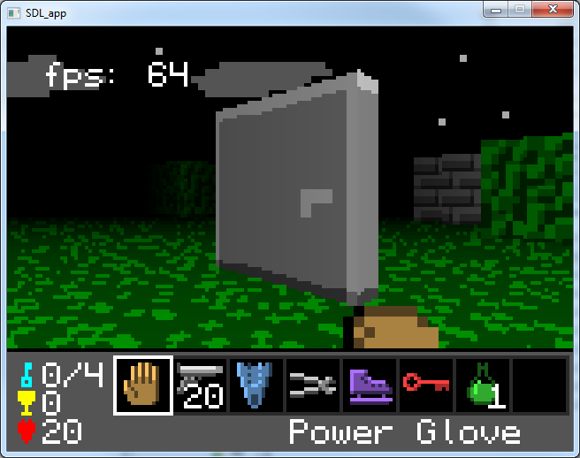
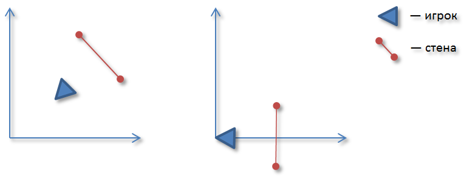
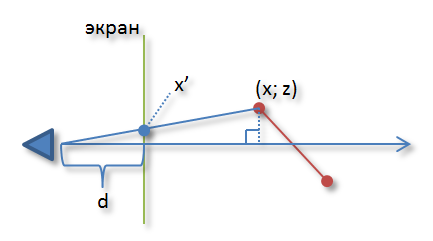

Начнем с незамысловатого [вопроса](http://gamedev.stackexchange.com/questions/33203/good-resources-for-2-5d-and-rendering-walls-floors-and-sprites) на [gamedev.stackexchange.com](http://gamedev.stackexchange.com/):
> I'm curious as to how games like Prelude of the chambered handle graphics. If you play for a bit you will see what I mean. It made me wonder how it works. (it is open-source so you can get the source on This page) I did find a few tutorials but I couldn't undertand some of the stuff but it did help with some things. However, I don't like doing things I don't understand. Does anyone know of any good sites for this kind of 2.5D? Any help is appreciated. After all I've been googling all day. Thanks :)

Aidan Mueller спрашивает, как были разработаны такие игры как [Prelude of the Chambered](http://s3.amazonaws.com/ld48/index.html) (PoC), и просит поделиться ссылками по теме. Кстати это интересная игра сама по себе. Она была написана Нотчем, создателем игры Minecraft, за 48 часов в ходе конкурса под названием Ludum Dare. Если вы еще не играли, то крайне советую, тем более игра с одной стороны короткая, а с другой увлекательная. В свое время меня тоже заинтересовал PoC с технологической точки зрения, и я начал погружаться в дикий и опасный мир программных рендеров.

Тогда мне было интересно дойти до всего самостоятельно, и я игнорировал оригинальные исходные коды. В скором времени мне под руку подвернулась замечательная [статья](http://lodev.org/cgtutor/raycasting.html) про рейкастинг, метод рендеринга, который позволял создать 3D перспективу на двумерной карте. Этот же подход в том или ином виде использовался в игре Wolfenstein. В тот момент мне показалось, что этого будет достаточно, чтобы реализовать все, что было в PoC. Но я ошибался.

Вся проблема заключалась в том, что рендер PoC`а поддерживал такие объекты как двери. Двери не в виде плоских спрайтов, а настоящие двери в виде блоков ассиметричной формы:

Это было непосильной задачей для простого рейкастера. Я пытался придумать способ как можно было бы хакнуть и заставить все-таки его отображать приятные глазу двери, но любой способ оказывался или слишком сложным или слишком дурацким. С рейкастером было покончено, и я решился заглянуть в оригинальные исходные коды.

Итак, функция *RenderWall*. Она была альфой и омегой всего рендера и предназначалась для рендеринга текстурированной стены в произвольном месте, заданном двумя двумерными координатами. Именно благодаря этой функции движок был способен рендерить блоки произвольной формы, включая многострадальные двери. Скажу честно, я потратил немало времени, чтобы дойти до всей математики самостоятельно, но сейчас, по прошествии времени, я уверен, что это всецело того стоило. Для начала упрощенный [листинг](https://gist.github.com/db54a3c62c6d42a5d6a6) из моего проекта. 

Что происходит? По шагам:

1) Перевод координат стены в систему координат игрока\
2) Отсечение невидимых участков стены\
3) Проекция стены на картинную плоскость (почти)\
4) Растеризация и текстурирование стены

1) Рендерить стены есть смысл лишь с точки зрения игрока. Для это и нужен переход из одной системы координат в другую. Игрок имеет три степени свободы (XY-координаты на карте и угол поворота относительно оси oX), поэтому для перехода достаточно вычесть координаты игрока и развернуть на соотвествующий угол. Графически это выглядит так:

2) Как рендерить участки стен, которые находятся между игроком и экраном (см. схему нижу)? Правильно: никак. Для этого и нужно отсечение. В противном случае получите ужасные графические артефакты.

3) Обычно в компьютерной графике под проецированием подразумевают процесс отображения трехмерных примитивов в двумерные на картинную плоскость. В нашем случае мы проецируем двумерные отрезки на экран. В итоге получаем пару точек. Для создания 3D перспективы этого недостаточно, хотя бы потому что все стены всегда будут одной высоты. Соответственно нужно что-то еще, а именно глубина, или расстояние данной точки от камеры. Рассмотрим схему:

Треугольник, который отмечен значком прямого угла, делится зеленым отрезком на два подобных треугольника. Соответственно можно выписать следующие формулы:

$$\frac{x'}{d} = \frac{x}{z}; \quad x' = d\,\frac{x}{z}$$

где d — расстояние от игрока до экрана, x’ — координата крайний точки стены после проецирования, а z — глубина. В листинге за d отвечает константа *nearPlaneDistance*.

4) Растеризация — процесс получения растрового изображения. Стена является четырехугольником и ограничена [*startX*, *endX*] по оси oX. Соотвественно мы должны пройти в цилке все точки по горизонтали и для каждой из нее определить текущую высоту стены с помощью линейной интерполяции между *lineHeight1* и *lineHeight2*, не забывая про тест на глубину. Остается лишь получить нужные тексель и вывести его на экран.

Важно отметить, что для рендеринга спрайтов, т.е. различных плоских объектов игрового мира типа противников, изобретать велосипед не нужно. Достаточно небольших модификаций уже готовой функции *RenderWall*. Правда это не касается полов и потолков, их нужно рендерить по другому принципу, но об этом в другой раз.
