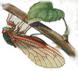

**Паскаль** говорил: *«Книга природы написана языком математики»*. Паскаль не врал.

 У периодических цикад, известных как **Magicicada septendecim**, самый длинный жизненный цикл из всех насекомых. Их жизнь начинается под землей, где личинки терпеливо сосут соки из корней деревьев. И лишь через 17 лет ожидания взрослые цикады появляются из-под земли, собираются в огромные рои и на какое-то время заполоняют все вокруг. За несколько недель они спариваются, откладывают яйца, а затем умирают.

Вопрос, который не давал биологам покоя, — почему жизненный цикл у цикад такой длинный? Имеет ли какое-нибудь значение для жизненного цикла то, что продолжительность его выражается простым числом лет? Другой вид — **Magicicada tredecim** — роится через каждые 13 лет. Это наводит на мысль, что продолжительность жизненного цикла, выражающаяся простым числом лет, дает виду определенные эволюционные преимущества.

Согласно одной теории, у цикады имеется паразит, также обладающий длинным жизненным циклом. Цикада, естественно, стремится избавиться от паразита. Если паразит обладает жизненным циклом продолжительностью, скажем 2 года, то цикада стремится избежать жизненного цикла, продолжительность которого в годах делится на 2, так как в противном случае цикада, появляясь из-под земли, и паразит регулярно встречались бы. Аналогично, если бы паразит обладал жизненным циклом продолжительностью 3 года, то цикада стремилась бы избегать жизненных циклов, продолжительность которых в годах выражалась числом, кратным 3. Следовательно, чтобы избежать совпадений с паразитом, лучшей стратегией для цикады было бы иметь жизненный цикл, длящийся простое число лет. Так как ни одно целое число (кроме 1 и 17) не делит число 17, Magicicada septendecim очень редко встречается со своим паразитом. Если продолжительность жизненного цикла паразита составляет 2 года, то цикада встречается с ним только раз в 34 года, а если продолжительность жизненного цикла паразита больше, например, составляет 16 лет, то его встреча с цикадой происходит лишь раз в 272 (= 16 · 17) года.

«Реванш» для паразита возможен только в двух случаях: при его годичном жизненном цикле и при жизненном цикле продолжительностью 17 лет. Маловероятно, однако, что паразит выживет на протяжении 17 своих поколений подряд, так как первым 16 поколениям будет не на ком паразитировать. С другой стороны, чтобы достичь 17-летней продолжительности жизненного цикла, поколениям паразита необходимо пройти в своей эволюции 16-летний жизненный цикл. Это означало бы, что на каком-то этапе эволюции паразит и цикада не встречались бы на протяжении 272 лет! И в том, и в другом случае большой жизненный цикл продолжительностью в простое число лет способствуют выживанию цикады.

Возможно, именно этим и объясняется, что пресловутый паразит так никогда и не был найден! В гонке на выживание с цикадой паразит, по-видимому, постоянно увеличивал продолжительность своего жизненного цикла до тех пор, пока не наткнулся на 16-летний барьер. После этого паразит на протяжении 272 лет не мог встретиться со своей жертвой и за это время вымер. В результате появилась цикада с жизненным циклом длиной 17 лет. Необходимость в более продолжительном жизненном цикле для цикады отпала, поскольку паразит более не существовал.

[Cicada song](http://en.wikipedia.org/wiki/Image:New_Zealand_cicada_song.ogg)
