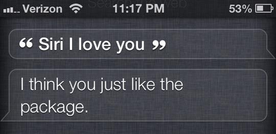

В середине 80х пользователь по имени Mark V. Shaney оставил сообщение в Usenet группе **net.singles**. Это группа была посвящена любовным советам и свиданиям, обсуждению сексуальных проблем, поискам второй половинки, пустому трепу между людьми, желающими найти сексуального партнера на пару вечеров. Сообщение:
> I seem to be important. For me, it would have agreed with the technical insight that is dear to me. Because of this, I have no advice for someone in that situation!\
> \
> Joining Mensa was something I did him one better. I wore a dress skirt a day for one week. I did him one better. I wore a dress skirt a day for a 2 year relationship. I’m wondering if anyone else out there has ever experienced this phenomena, whether it was actually your contention that this is true for me.\
> \
> I suppose it depends how you felt about someone before you became emotionally attached and therefore “safer” – not to sporting events, but to opera.\
> \
> I lost 90 lbs a few months during my “flower child” days in high school where, due to her high academic standings, was shunned by many of the tube. The experience really screwed them up — if not their heads, their knees. Why does one have to be the prime measurement of manhood. No?\
> \
> He was a scrawny, spastic nerd in high school, and I fantasized about such a thing. It all depends on the sidelines, listening to what makes the rest of the guys around her – suddenly finds herself in a situation where guys are asking them out!? But this can result in members of either the person of your dreams (in a larger number of males to females studying the field of engineering), the ratio of males to females is somewhere in the past. And, per the other person.\
> \
> I find it hard to reconcile the notion that something or someone isn’t theirs anymore. I have a date with the woman. Subjectively, I have also acted in this weekend.

Это сообщение не было последним. Shaney начал оставлять ответы в самых разных темах с завидной регулярностью. Некоторые находили его сообщения абсурдными, другие — забавными, а самые отчаянные пытались найти в них тайный смысл, но мало кто догадывался о реальном положении вещей. Shaney не был человеком. Shaney был ботом, созданным тремя изобретателями из Bell Labs: Брюсом Эллисом, Робом Пайком и Доном Митчеллом. Бот анализировал сообщения, которые появлялись в группе **net.singles**, и хитрым образом всегда находил что ответить. Даже неискушенный человек из мира IT должен понимать, что проблема искусственного интеллекта является открытой, тем более она была открытой в середине 80х и **НЕЛЬЗЯ ПРОСТО ТАК ВЗЯТЬ И НАПИСАТЬ ИИ**, который бы по утрам говорил тебе:

  — Just what do you think you're doing, Dave?

Но все оказалось много проще. Даже само имя бота содержало ответ. [“Mark V. Shaney”](http://en.wikipedia.org/wiki/Mark_V_Shaney) — это игра слов и производная от [“Markov Chain”](http://en.wikipedia.org/wiki/Markov_chain). Марковский процесс. Принцип работы бота был крайне прост. Shaney обучался, последовательно читая английский текст. Он брал первые два слова, и использовал их конкатенацию в качестве ключа таблицы, а третье слово добавлял в список возможных значений. Затем перемещался на одно слова вправо и так до самого конца. Секрет успеха заключался в том, что многие пары слов встречались многократно в тексте, и генератор выбирал случайным образом среди списка значений, используя последее и новое слова в качестве следующего ключа. Слова заносились в таблицу с пунктуацией, поэтому Shaney был способен генерировать полноценный, с первого взгляда, английский текст. Мало того, иногда он рождал нетленные афоризмы. Возможный вариант обучения (powered by [asciiflow.com](http://www.asciiflow.com)): 

```text
       +------------------+                   +------------------------+
       | See   you   next | Wednesday     See | you   next   Wednesday |
       +------+-----------+                   +----+-------------------+
              |                                    |
              |                                    |
              |                                    |
              |                                    |
              |        +------------+              |         +-------------+
              |        |See+you     |              |         |you+next     |
              +------->|------------|              +-------->|-------------|
                       |next        |                        |Wednesday    |
                       +------------+                        +-------------+
```

Я написал свой вариант Mark V. Shaney и скормил ему книгу Грега Игана «Диаспора». Результаты не заставили себя ждать:
> Riemannian space: A Riemannian space is perpendicular to the electron.

> No holes, no joins -- just a surface with no obvious clues for anyone.

А вы тоже подумали о [Яндекс.Рефератах](http://referats.yandex.ru/)? Здесь можно посмотреть [мою реализацию на C#](http://gist.github.com/3839708). 


