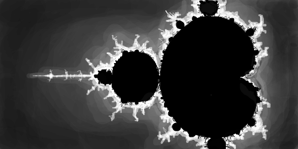

Давным-давно я наткнулся в интернете на очень занимательный сайт под названием [“The International Obfuscated C Code Contest”](http://www.ioccc.org/) или “IOCCC” или «Интернациональный контест по обфускации С-кода».

Цели контекста:

1. Написать наиболее мутный и обфусцированный С-код в рамках правил
2. Показать важность стилей программирования, в ироническом виде
3. Испытать С-компилятор необычным кодом
4. Продемонстрировать некоторые тонкости языка С
5. Обеспечить безопасное место для безобразного С-кода

Для тех, кто до сих пор в танке, [обфускация](http://ru.wikipedia.org/wiki/Обфускация) — сознательный или бессознательный процесс запутывания исходного кода с целью свести с ума будущих читателей. Также как и рефакторинг, обфускация не меняет функциональности программы, а лишь нарушает организацию и внешний вид исходного кода. Я до сих пор помню, как одноклассник на уроке информатики копировал с экрана моего монитора лесенку. Так вот, если этот процесс пустить вспять, то это и будет примитивный пример обфускации.

Вернемся к контесту. Кратко говоря, участники должны написать максимально непонятный код, который бы при этом делал что-то интересное. Особым шиком считается оформить исходный код в виде ASCII-графики, желательно при этом, чтобы изображение имело отношение к задумке самой программы. Я тоже решил попробовать свои силы и быстро сваял программу, которая выводит в консоли множество Мандельброта. Это был первый этап и вот результаты работы:

```text
                                              ****
                                              ****
                                        *  **********
                                        *****************
                                      *******************
                                     *********************
                           *******  **********************
                          ********* **********************
               *****************************************
                          ********* **********************
                           *******  **********************
                                     *********************
                                      *******************
                                        *****************
                                        *  **********
                                              ****
                                              ****
```

Дальше я решил сосредоточиться не на самой обфускации, а на оформлении кода. Форматировать код руками — муторно и долго, поэтому я… правильно, написал [еще одну программу](http://gist.github.com/3920066). На вход она принимает два файла: схему и код. В качестве схемы выступает вывод предыдущей программы, т.е. множество Мандельброта. Идея состоит в том, что новая программа должна пытаться рассредоточить код таким образом, чтобы он максимально точно повторял изображение на схеме. Программа незамысловатая, но есть интересные моменты:

1. Файлы считываются в строки с помощью *read\_into\_string()*
2. Во время считывания происходит препроцессинг кода: символы “{}();,” окружаются пробелами
3. Препроцессинг нужен для того, чтобы *sscanf()* правильно распознавал все токены, т.е. понимал, что *for(* — два разных токена
4. Грубо говоря, процедура *format()* последовательно читает токены из кода и ждет пока в схеме наберется нужное количество звездочек, после этого токен выводится
5. Процедура *format()* распознает ситуацию, когда рядом идут два символьных токена, чтобы при выводе между ними вставить, как минимум, один пробел, т.е. чтобы в выводе не было: *floatx*

Я запустил программу и получил следующее:

```c
                                              void
                                              zxc()
                                        {  for(float y
                                        =-1.0f;y<1.0f;y+=0.1f
                                      ){for(float x=-2.5f;
                                     x<1.0f;x+=0.05f){const
                           float   escapeR=100.0f;float zx=
                          0.0f; float zy=0.0f;float tx=0.0f
               ;float ty=0.0f;int n=100;float mod=0.0f;while
                          (n>=0&& mod<escapeR){zx=tx*tx-ty*
                           ty+x;zy  =2.0f*tx*ty+y;tx=zx;ty=
                                     zy;--n;mod=sqrt(zx*zx+
                                      zy*zy);}printf("%c",
                                        n>=0?'_':'*');}printf
                                        (  "\n");}}void
                                              main(){
                                              zxc();}
```

И она даже комплириуется. Впрочем мне больше по душе живой фрактал Мандельброта под авторством Д. :)


