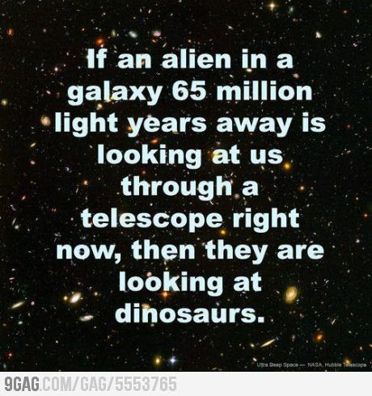
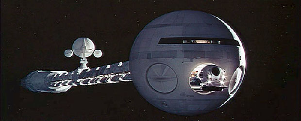
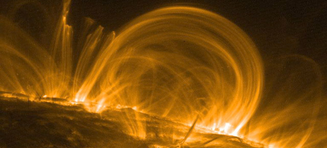

Из интервью с Бредбери:
> — В 1950 году вы написали книгу, принёсшую вам всемирную славу, — сборник рассказов «Марсианские хроники». Там говорилось: уже к началу второго тысячелетия на Марсе будут поселения, целые города землян. Как вы думаете, почему этого в итоге так и не произошло?\
> \
> — Меня часто про такое спрашивают, и я люблю фантазировать над ответами. Чтобы они были разными! Ответ сегодняшнего дня: потому что люди — идиоты. Они сделали кучу глупостей: придумывали костюмы для собак, должность рекламного менеджера и штуки вроде айфона, не получив взамен ничего, кроме кислого послевкусия. А вот если бы мы развивали науку, осваивали Луну, Марс, Венеру… Кто знает, каким был бы мир тогда? Человечеству дали возможность бороздить космос, но оно хочет заниматься потреблением - пить пиво и смотреть сериалы. Вы особенно не обращайте внимания, это старческое брюзжание (смеётся) — мне же скоро сто лет.

Как известно, самый верный способ стать философом — регулярно смотреть на звездное небо. Скорей всего именно по сей причине в Древней Греции было так много философов. А чем еще было заняться потомкам Эллина? Ящик с трубадурами не изобрели, папирусы лишь входили в моду, да и стоили умопомрачительных драхм, с интернетом тоже не сложилось. Вот и оставалось сидеть и любоваться ночным небом, тем более средиземноморский климат этому всецело способствовал.

Космос поражал и поражает с разных сторон. *В первую очередь это масштабы*. Когда смотришь на звезды, обычно думаешь что они «далеко», может даже «очень далеко». Едва ли. Далеко до деревни, где живет бабушка, очень далеко до Калифорнии. А до звезд не далеко. Просто не существует бытовых понятий, которые бы могли объективно оценить расстояние до звезд, пусть и ближайших. Интуиция человека перестает работать, когда счет идет на световые года. В лучшем случае ему кажется, что он осознает масштаб расстояний. Но хуже незнания есть лишь уверенность в ошибочном знании.

Не стоит расстраиваться, что человеческий мозг пасует перед космическими масштабами. В этом виновата проклятая эволюция, сконструировавшая глаз человека таким образом, что он уже видит мало разницы между звездой и одиноким спутником. Ввиду этого нужна особая практика, чтобы хотя бы в первом приближении научиться оценивать мировые масштабы. Астрономы с годами этому учатся, наверное.

Перейдем к цифрам. Человек побывал на Луне. [Среднее расстояние от Земли до Луны](http://www.wolframalpha.com/input/?i=distance+from+moon+to+earth) составляет 389 тысяч километров. Это, безусловно, немного и вполне осознаваемо. Автомобиль с таким пробегом не вызвал бы особого удивления. До Марса уже дальше. Здесь начинается счет на астрономические единицы (1 а.е. — среднее расстояние от Земли до Солнца) и расстояние теперь составляет практически 2 а.е. Подобные расстояния не без труда преодолевают космические корабли с роботизированной техникой на борту (привет, Curiosity). Но и это конечно не предел. Было отправлено целое множество спутников для исследования внешних планет: Юпитера, Сатурна. А некоторые отработавшие свое спутники до сих пор бороздят вакуум, устанавливая новые рекорды. Это в первую очередь касается [Вояджера 1](http://www.wolframalpha.com/input/?i=voyager+1), который находится сейчас на расстоянии 122 а.е. от Солнца. Рубикон.

Возвращаясь к полетам на Луну. Интересно как соотносится расстояние до спутника Земли с расстоянием до ближайшей звезды. [Проксиму Центавру](http://www.wolframalpha.com/input/?i=Proxima+Centauri) отделяет от нас 4,2 световых года пустоты. [Вольфрам знает ответ](http://www.wolframalpha.com/input/?i=%28distance+from+sun+to+Proxima+Centauri%29+%2F+%28distance+from+earth+to+moon%29): 101,4 миллиона или 101400000. Если предположить что в будущем человек сможет добираться до Луны за один час, то на огонек в системе Альфа Центавра его можно будет ожидать через 11568 полноценных Григорианских лет или 410 поколений.

Возникает закономерный вопрос, а сможем ли мы вообще добраться когда-либо до звезд? Цивилизация развивается, вопрос заостряется. Конечно, маловероятно, что пророчества Майя реализуются и нам придется массово эмигрировать в конце 2012 года, но настанет час, когда выбора точно не будет. И уповать на то, что человек, как в мечтах Азимова и Кубрика, станет космическим дитём, тоже не стоит.

Что мы имеем? На каком самом быстром космическом аппарате летал человек? Вы не поверите. Это были все те же 60е, люди развлекались как могли и летали на Луну. Командный модуль Аполлона 10 развил [максимальную скорость](http://www.wolframalpha.com/input/?i=fastest+spacecraft) относительно Земли, и она составила 39896 км/час или 11 км/c. [С такой скоростью плестись до ближайшей звезды](http://www.wolframalpha.com/input/?i=%28distance+from+Earth+to+Proxima+Centauri%29+%2F+24790+mph) всего ничего, а именно: 1 миллиард часов или 114110 лет. Лучше бы и не считали. Важно отметить, что для выхода за пределы солнечной системы, телу на Земле нужно сообщить третью космическая скорость, т.е. как минимум 16,6 км/с.

Очевидно, что на традиционных ракетах химического типа не удастся долететь не то что до звезд, но даже и до ближайших планет. Основной характеристикой эффективности ракетного двигателя выступает удельный импульс. Он примерно равен скорости истечения продуктов сгорания, но измеряется в секундах. **Химические реактивные двигатели** типа [Сатурн-5](http://ru.wikipedia.org/wiki/Сатурн-5) сжигают огромное количество топлива в единицу времени, но скорость истечения относительно мала. Удельный импульс составляет 400-500 секунд, и это ближе ко дну эффективности. К тому же топливные резервуары на подобных ракетах истощаются с катастрофической скоростью, и безразмерное увеличение топливных запасов также не решает проблему, а лишь усугубляет, ведь приходится разгонять не только полезный груз, а и топливо.

После подобных размышлений sci-fi фильмы, в которых из недр огромных кораблей вырываются потоки пламени, вызывают лишь усмешку. Но конечно химическими реактивными двигателями дело не ограничивается.

**Ионные и плазменные двигатели**! Они не создают внезапного и эффективного выброса раскалённых газов, которые толкают традиционные ракеты. Их тяга измеряется не в тоннах, а в граммах. Если их положить на стол, то они бы не сдвинулись даже с места. Но все это с лихвой компенсируется способностью работать в открытом космосе на протяжении многих лет. Принцип работы основан на выбросе слабого потока ионизированных атомов через сопло. Ионы в свою очередь генерируются раскаленной нитью, через которую пропускают некоторый газ, к примеру, ксенон. Ионные двигатели не являются прототипом, реальные аппараты уже были испытаны в космосе. Они обладают значительно б*о*льшим удельным импульсом: ионные — 3000 с, плазменные — 1000-30000 с. Но у подобных двигателей все равно не хватит сил, чтобы доставить нас к звездам, хотя они и могли бы стать непритязательными рабочими лошадками в межпланетных путешествиях.

Из научно-фантастических романов в реальную жизнь перекочевали экзотические типы двигателей. Самый популярный из них — **солнечный парус**. Автором идеи выступает средневековый писатель-фантаст Иоганн Кеплер, который к тому же еще выдумал три закона ~~роботехники~~ орбитального движения. Идея состоит в том, что свет звезды или любой другой поток фотонов оказывает постоянное давление на огромный парус, сцепленный с полезным грузом. Минимальное давление, едва уловимое точными приборами. Несмотря на все сложности, в космосе уже испытали несколько моделей с разной степенью успешности. Но одно дело построить пятнадцатиметровый парус, а другое — парус, способный доставить человека к звездам. Он должен быть невероятных размеров и конструировать его нужно исключительно в открытом космосе. Сторонники идеи уже предложили интересные модернизации. К примеру, соорудить на Луне батарею лазеров, направленных на парус и толкающих его в нужном направлении. Конечно это чудовищный проект с финансовой точки зрения, да и в любом случае остается проблема… торможения и возвращения назад. Маловероятно, что удастся по радио договориться с представителями внеземной цивилизации и заставить их построить сходную батарею лазеров на одном из своих спутников.

Эволюция ракетостроения в чем-то схожа с эволюцией источников энергии. И **прямоточные термоядерные двигатели** является таким же прорывом в эффективности, как и энергия мирного атома в свое время. В ходе ядерных реакций выделяется колоссальное количество энергии в сравнении со сжиганием того же бензина в цилиндрах автомобилей. Тем более любой источник энергии на Земле является производным и вторичным по отношению к энергии, которая генерируется Солнцем. Ему мы обязаны всем.

Секрет успеха Солнца — в реакциях термоядерного синтеза. Синтез подразумевает превращение легких элементов в тяжелые с выделением энергии. Главная реакция — превращение водорода в гелий. Это и неудивительно, так как водород является самым распространенным элементом во вселенной. Термоядерные двигатели работают на той же основе. Для создания тяги используется истечение продуктов управляемой термоядерной реакции или рабочего тела, нагретого за счет энергии той же реакции. Мало того что данный тип двигателей имеет большой удельный импульс (2500-200000 с), так еще и необязательно перевозить с собой топливо, так как его можно собирать из окружающего пространства по ходу движения. Обратной стороной медали выступают вопросы безопасности, в частности, радиация и защита от цепных реакций, которые бы могли разрушить двигатель и все что его окружает в мгновение ока.

В теории можно было бы сконструировать термоядерный двигатель, который бы давал постоянное ускорение в 1 g. [За пол года работы](http://www.wolframalpha.com/input/?i=0.5+year+*+9.8+m%2Fs%5E2) подобный двигатель разогнал бы корабль до половины скорости света. В теории. Все упирается в сложность и безопасность.

Самым эффективным двигателям был бы двигатель, работающий на аннигиляции вещества и антивещества. Удельный импульс последних в десятки раз больше термоядерных: 1000000-10000000 с. Все вещество превращается в лучистую энергию (привет, е-м-ц-квадрат), тогда как в ходе реакции водород-гелий — лишь доля процента. Антивещество уже получено на Земле, правда в минимальных количествах и является самым дорогим веществом (легкий оксюморон) во Вселенной.

Рассуждения отрезвляют и приземляют. Многие проблемы звездоплавания упираются даже не в сам факт огромных расстояний, а в… человека. Все затевается ради легкоуязвимого и неудобного куска мяса, для жизнеобеспечения которого нужны тепличные условия, земной климат в миниатюре. Если бы удалось исключить человека из уравнения, то задача бы сильно упростилась. Ибо сконструировать и отправить к звездам микрокорабль много легче. Но в таком случае пропадает спортивный интерес, драма. Один из вариантов — перевод человека в цифровую реальность. Но сложно представить, во что в таком случае выродится род человеческий, и будут ли ему вообще интересны звезды.

Как говорится, теория должна быть достаточно безумной и абсурдной, чтобы быть правдой. Таким же, по моему мнению, должен быть и проект звездных путешествий. Я лично предпочитаю вариант с отправкой человека в самом компактном виде, т.е. в виде сперматозоида и яйцеклетки. По прилету такой корабль мог бы итеративно создавать сооружения б*о*льшей и б*о*льшей сложности из подручных материалов. Построить фабрику по выращиванию людей и воспитывать их в виртуальной реальности. Это будет странный человек, но человек. И тогда произойдет величайшее свершение: нога живого человека из плоти и крови ступит на планету другой звездной системы.
