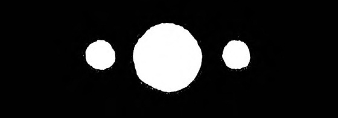
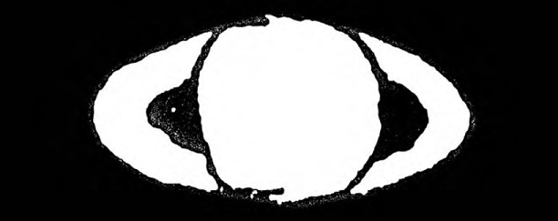
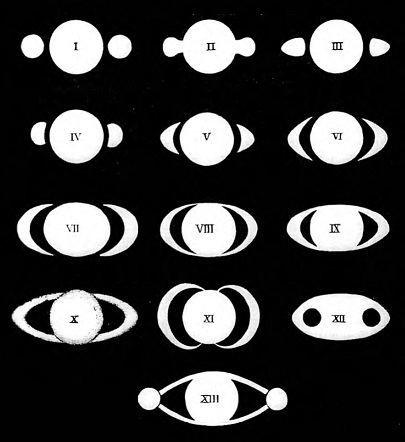

В начале XVII века произошла одна из самых невообразимых историй, а ее главным героем естественно был Галилей. В то время люди лишь начинали вглядываться в окуляр телескопа, и их взору открывался неизведанный новый мир. И, безусловно, самым потрясающим объектом для наблюдений был и остается Сатурн со своими вечномолодыми кольцами. Эту историю я прочел в [одной](http://www.amazon.com/Cassini-Saturn-Huygens-Springer-Exploration/dp/038726129X) книге и теперь она здесь.

В июле 1610 года Галилей наткнулся на настоящее чудо: диск Сатурна по бокам обладал хорошо различимыми отростками. Он написал Кеплеру об открытии *Saturnus* *triformis* примерно следующее: «Дорогой Иоганн, не сочти меня душевнобольным, но после наблюдений наиболее отдаленной планеты я пришел к выводу, что она располагает тройной формой». Однако Галилей использовал тайнопись, что было в духе времени, которую Кеплер впоследствии ошибочно истолковал, и у него вышло, что уже у Марса было два отростка, т.е. луны. Ошибка в частности была вызвана глубокой верой Кеплера в божественную космическую прогрессию: у Земли ровно один спутник, у Марса — два, а у Юпитера — целых четыре (на то время). У Венеры в свою очередь вообще не было спутников.

«Сатурн не одинок», — Галилей позднее писал Медичи, «он состоит из трех частей, которые практически соприкасаются друг с другом и никогда не изменяют относительного положения. Они выстроены в ряд параллельно плоскости эклиптики, а центральная часть больше остальных в три раза».

Первая зарисовка Галилея выглядела так:

Мы же в свою очередь ничем не хуже и с помощью вольфрама можем заглянуть в [прошлое](http://www.wolframalpha.com/input/?i=saturn+at+1611).*[image lost: picture — original URL: https://www.ljplus.ru/img4/i/o/io32/wolfram.jpg]*

Галилей продолжил свои наблюдения вплоть до 1611 года. Отростки или *ansae* становились все менее и менее уловимымы, а в 1612 году и вовсе исчезли, оставив после себя мало примечательный центральный диск. Это не только озадачило, но и обеспокоило великого ученого, ввиду того что ранее его открытие спутников Юпитера уже подвергалось критике со стороны традиционных до-телескопических астрономов и философов. Все шло к тому, что они его высмеют в очередной раз.

Галилей предчувствовал  неудачу и счел, что его первый телескоп был неисправен. Он начал работать над его усовершенствованием вплоть до 1616 года, пока снова не направил телескоп на Сатурн. На этот раз планета представилась ему ещё более загадочной, и он решил бросить свои изыскания. Сейчас, оглядываясь назад, мы видим явные кольца вокруг планеты, но в те времена Галилей пришел в замешательство и не распознал *ansae* как таковые:

Однако интерес к этому космическому триединству только рос. В 1614 году Шранейр отметил, что *ansae* снова появились, тем самым спасли честь Галилея. Он также наблюдал, как меняется структура отростков со временем: сначала это были «тонкие руки», затем внутри них образовалась черная брешь, а в течение следующих семи лет руки неуклонно приближались к центральному диску, пока и вовсе не сомкнулись.

Когда Риччиоли, итальянский астроном из Болоньи, рассматривал Сатурн в 1640 году, он увидел *ansae* в виде знакомых тонких рук. Но в 1641 они снова исчезли, ненадолго, чтобы через короткое время дать начало новому циклу. С 1647 по 1650 он следил за их эволюцией, а в 1651 году резюмировал свои наблюдения в опубликованной книге.

И напоследок различные ранние зарисовки колец Сатурна: I: Галилей, 1610; II: Шрайнер, 1614; III: Риччиоли, 1641 или 1643; IV-VII: Гевелий, 1645; VIII, IX: Риччиоли, 1648-1650;  X: Дивини, 1646-1648; XI: Фотана, 1636; XII: Бианчини, 1616; XIII: Фонтана, 1644-1645. Изображение взято из книги *System* *Saturnium* Христиана Гюйгенса, 1659 год:

