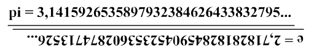

Когда-то давно **Гольдбах** сформулировал своё знаменитое утверждение, что любое чётное число, которое больше или равно двум, может быть представлено в виде суммы двух простых. Например, 8 = 5+3. В начале прошлого века **Гильберт**, составляя список великих недоказанных гипотез математики, включил в него и Гольдбаха тоже. Утверждение не доказано до сих пор. Самое интересное, что оно абсолютно бесполезно в практическом плане, но тем самым оно интереснее для математиков.

Список Гильберта изрядно измельчал и устарел за целый век. Что ж, пора его пополнить новой задачей (моей!), которая на порядок сложнее и на порядок бесполезней. Вот она:

*Пусть pi(n) и e(n) функции, которые возвращают n-ые цифры иррациональных чисел **pi** и **e** соответственно. Доказать или опровергнуть, что при n=0.. ∞:*

*pi(n) = lim( e(N-n) ) , где N – количество знаков в числах (N→∞).*

Другими словами, нужно выяснить, равно или нет число **pi** числу **e**, если последнее записать задом наперед и расставить правильно запятые. Вот так.

**[update]** Задача решена элегантно и просто [**connected**](http://connected.livejournal.com/), подробности в комментариях. Ура!****\****
