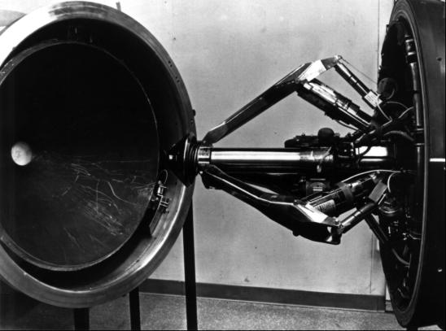
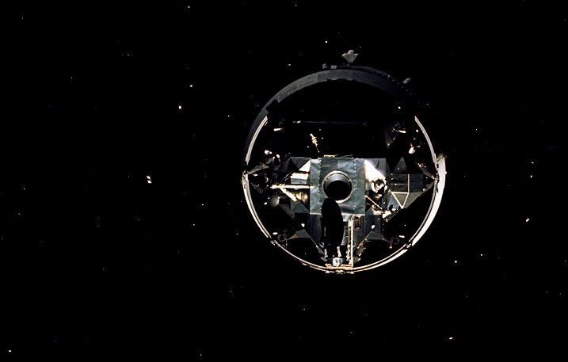

Наверное, каждый, кто прочитает заголовок, сразу же воскликнет: «Ага! Звук не распространяется в пустом пространстве, это невозможно». Не буду спорить. С другой стороны все мы видели множество забавных фантастических фильмов, где удаленная камера свободно записывала ударные волны от взрывающихся космических кораблей, от проносящихся мимо лазерных или плазменных лучей, иногда даже удавалось услышать потрескивание пламени на обшивках погибших кораблей, при этом вопрос о пламени лучше вообще не поднимать.

А теперь самое интересное. История эта случилась в апреле 1972 года где-то в дороге между Луной и Землей в ходе миссии «Аполлон-16». Лунный модуль находился на последней ступени ракетоносителя, и оставалось дело за малым: осуществить его стыковку с командным модулем. Для стыковки использовалось специальное устройство — *probe and drogue docking mechanism*. Одна часть этого механизма в виде пневматического штыря на треноге находилась на командном модуле, а другая, в виде воронки — на лунном. В ходе стыковки штырь должен был скользить по стенкам горловины, а затем попасть в отверстие, после чего срабатывало множество фиксирующих механизмов. Все гениальное просто!

Так вот, Томас Матингли, пилот командного модуля, наблюдал за приближением лунного модуля, и внезапно услышал сильный шум, который начал исходить из системы реактивного управления (Reaction Control System, RCS). «Я не слышал шума, когда мы отделялись от третей ступени, не слышал ничего, когда мы осуществляли различные пространственные маневры, все было тихо вплоть до непосредственного сближения. Я клянусь, знаю, что это невозможно, но я клянусь что слышал, как реактивная струя ударялась о лунный модуль перед стыковкой». Это его крайне удивило. Звук не может распространяться в вакууме, но он отчетливо слышал, как струя обтекала лунный модуль. Впоследствии он предположил, что продукты горения из RCS создали легкую разреженную атмосферу вокруг космического корабля, по которой и распространялись звуковые волны.

Он продолжил, «И вы, несомненно, могли увидеть это своими глазами. Я наблюдал, как вибрирует корпус лунного модуля и знал, что это обязано вызывать шум. Я слышал этот шум каждый раз когда мы включали двигатели. Я не был уверен, достаточно ли этой импровизированной атмосферы для того, чтобы отразить ударную волну, которую можно было бы затем услышать. Я не знал как оно на самом деле». Командир миссии Джон Янг поддержал своего пилота. «Думаю, что это возможно, Томас, газ вырывается наружу из двигателей, возвращается обратно и ударяется о корабль. Там действительно много частиц».

