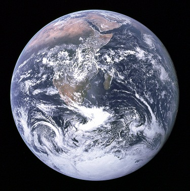
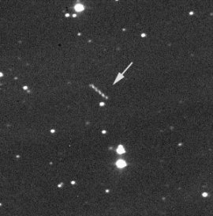
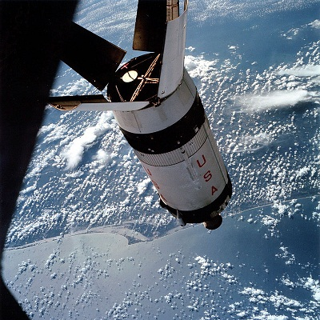

Тема «Аполлонов» крепко захватила этот журнал. Кто-то может сказать, что это уже все дела давно минувших дней и ничего кроме истории и старых свидетелей нас с ней не связывает. Но нельзя историю, тем более историю такого грандиозного события, воспринимать как нагромождение малосвязанных фактов, чей удел лишь валяться на пыльной свалке. Сложно даже представить, как сильно изменился мир после яркого заявления Джона Кеннеди *«Мы решаем идти на Луну»* в начале 60х годов. Вспомните хотя бы невероятные фотографии полной Земли, сделанные астронавтами, когда те находились в дороге между двумя мирами. Ведь именно благодаря тем фотоснимкам люди впервые увидели планету во всем её великолепии: голубую жемчужину в безмятежном черном океане космоса. Тогда же в головы людей начала вкрадываться идея насколько хрупок и ценен тот мир, в котором они и мы живем.

«К значит Космос», писал Брэдбери, и он обладает одним удивительным свойством: способностью сохранять истории навеки. Прошло 30 лет с момента запуска «Аполлонов», когда в сентябре 2002 года астроном-любитель Билл Янг увидел странный объект в созвездии Рыб, вращающийся вокруг Земли с периодом в 48 дней. Он описал его как облачко света 16 звездной величины (для сравнения, яркая звезда имеет 0 величину, а самый тусклый объект, видимый в земной телескоп, — 25). И дал ему не слишком романтическое название [J002E3](http://en.wikipedia.org/wiki/J002E3).

Автоматические системы обнаружения астероидов просматривали небо каждые несколько недель, но до этого не было никаких признаков объекта Янга. Он также не соответствовал ни одному из космических кораблей, которые запускали в те времена. Все говорило в пользу того, что J002E3 лишь недавно попал в поле действия Земли и таким образом представлял собой самую настоящую загадку. 

Спектроскопический анализ выявил, что поверхность странного объекта покрыта оксидом титана, который обычно входит в состав лакокрасочных изделий. Таким образом, это был не астероид. Баллистические расчеты показали: небесный путешественник до этого находился на гелиоцентрической орбите и незадолго до момента обнаружения попал в сферу действия системы Земля-Луна, что трагическим образом и изменило его орбиту. Но самый интересный вопрос оставался впереди. Откуда?

Моделирование с участием множества небесных тел дало ответ: объект уже был в данном районе в далеком 1971 году, после этого совершил около 30 оборотов вокруг Солнца, и в 2002 году вернулся обратно. А, как известно, в 1971 году в самом разгаре были «Аполлоны», а конкретно — миссия «Аполлон-14»! Но была одна проблема: в ходе той миссии две первые ступени ракеты Сатурн-5 вернулись на Землю, а третья под названием [S-IVB](http://ru.wikipedia.org/wiki/S-IVB), как и предполагалось, врезалась в Луну. Это было не праздное развлечение: каждая миссия устанавливала по одному сейсмографу на поверхности Луны, составляя таким образом сеть, а третья ступень играла роль небольшого метеорита: момент столкновения четко фиксировался, а затем ученые изучали динамику распространения ударных волн.

Если взглянуть на орбиту движения объекта [здесь](http://neo.jpl.nasa.gov/j002e3.html) или [здесь](http://neo.jpl.nasa.gov/j002e3/j002e3d.gif), то можно увидеть насколько она замысловата. Космический странник обращался вокруг Солнца, затем пересек так называемую точку L1 и попал в сферу действия системы Земля-Луна. Точка L1 — это [точка Лагранжа](http://ru.wikipedia.org/wiki/%D0%A2%D0%BE%D1%87%D0%BA%D0%B8_%D0%9B%D0%B0%D0%B3%D1%80%D0%B0%D0%BD%D0%B6%D0%B0), в которой пробный объект с пренебрежимо малой массой в системе из двух массивных тел может оставаться неподвижным относительно этих тел.

Продолжим. Подозрения переместилось с «Аполлон-14» на «Аполлон-12». В ходе той миссии командование не отправляло ступень на встречу с Луной, потому что на её поверхности ещё не было рабочих сейсмографов: прибор, который установили Армстронг и Олдрин в ходе первой лунной миссии, не пережил холодной ночи и вышел из строя. 

Космический корабль «Аполлон-12» отбросил 18-метровую третью ступень в ноябре 1969 года. После того как она отдалилась на безопасное расстояние, командный центр повторно запустил её двигатели и отправил на гелиоцентрическую орбиту. Но тяга была рассчитана не точно, и ступень вместо этого перешла не нестабильную орбиту вокруг системы Земля-Луна, после чего исчезла из области видимости.

Такая история. Третья ступень миссии «Аполлон-12» совершила фантастическое путешествие продолжительностью в 30 лет. В июне 2003 она опять перешла на гелиоцентрическую орбиту, но обязательно вернется в будущем. Однако стоит подчеркнуть, что *достоверно* природа объекта не известна. И все может оказаться много интересней, однако это мы узнаем уже в 2032 году.
