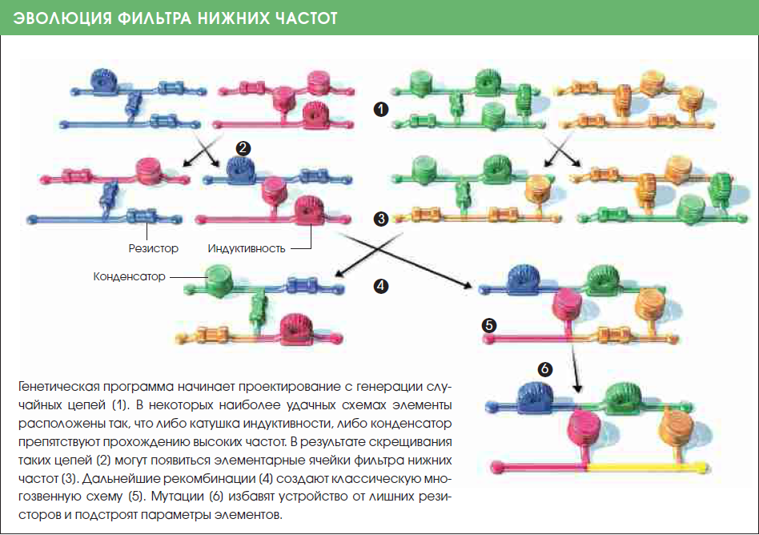

Когда-то я учился в университете и нас из года в год пичкали всякими задачами оптимизации и подходами к их решению. Особое место, безусловно, занимало эволюционное программирование с генетическими алгоритмами. Все было достаточно прозаично: была многомерная функция фитнесса, по которой происходил отбор, и был сонм организмов с хромосомами, которые жили, мутировали и, конечно же, размножались. Обычно где-то после сотни-другой поколений мы нажимали кнопку СТОП, и результаты работы с любовью копировали в отчет.

Написанные программы были простенькими, без особых претензий, как впрочем и круг задач: там аппроксимировать функцию, погонять коммивояжера, сыграть в бога и организовать искусственную жизнь.

Столь милые воспоминания о генетических алгоритмах у меня бы, наверное, остались до конца моих дней, если бы не одна статья в журнале «В Мире Науки» за июнь 2003 года. Две тысячи третий год — это год когда я только поступил в университет.

Статья называется «Эволюция в мире изобретений». А в кратком предисловии написано что

*Компьютерные программы, основанные на дарвиновских принципах эволюции, создают изобретения, достойные патентов.*

И это тот случай, когда сказали именно правду. После краткого введения в суть дела авторы (Джон Коза, Мартин Кин и Мэтью Стритер) рассказывают, что с помощью эволюционного (генетического) программирования удалось повторить 15 важнейших изобретений в области радиоэлектроники, при этом шесть из них были недавно (на 2003 год) запатентованы ведущими исследовательскими институтами. Дальше они пишут, что некоторые из автоматически созданных схем откровенно повторяют старые инженерные решения, а другие воспроизводят функциональные возможности хорошо известных устройств новым и порой более удачным образом. Вот так, не больше, не меньше!

А вот иллюстрация, которая на примере показывает физику процесса:

Радиоэлектронные изобретения, воспроизведенные компьютером, мне мало о чем говорят, но вот некоторые из них:

- Многозвенный фильтр (1917 год)
- Сортурующая схема (1962 год)
- Кубический преобразователь (2000 год)

В конце статьи представлено ещё несколько интересных разработок, которые уже гораздо ближе к моей реальности:

- АНАЛОГОВАЯ СХЕМА РЕАЛЬНОГО ВРЕМЕНИ для оптимального управления роботом
- ВЫВЕДЕНИЕ ЛЕЙТМОТИВОВ (хорошо сохраняющихся фрагментов аминокислот) для идентификации некоторых семейств белков
- АЛГОРИТМЫ ДЛЯ КВАНТОВЫХ КОМПЬЮТЕРОВ, которые в ряде случаев решают задачи лучше, чем любой из ранее опубликованных
- ЛОГИЧЕСКАЯ СХЕМА для выполнения операции «НЕ–И» по двум входам
- АНАЛОГОВЫЕ СХЕМЫ ДЛЯ ВЫЧИСЛЕНИЯ квадрата, куба, квадратного и кубического корня, логарифма и функций Гаусса
- СХЕМЫ ЦИФРО-АНАЛОГОВОГО И АНАЛОГО-ЦИФРОВОГО ПРЕОБРАЗОВАТЕЛЕЙ.

Вот где-то так. К чему это я? А к тому, что это все было известно уже в 2003 году, когда я только готовился стать студентом. А потом меня пять лет учили, как с помощью этих алгоритмов можно решать самые элементарные задачи, для которых бы хватило и карандаша с бумагой. То, что нам представляли как науку будущего, уже вовсю применяли на практике, причем очень успешно. Ну просто п... 

Кому интересно вот [ссылка](http://rapidshare.com/files/206783880/V_Mire_Nauki_2003_06.rar) на тот выпуск журнала.


