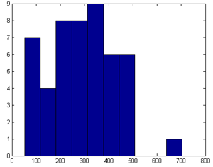

**Интересно**, а кто-то пытался статистически анализировать номера, которые живой журнал назначает новым записям. Неважно. Это попробую сделать я :)

В моём журнале всего 60 с лишним постов, ссылка на предпоследний из них выглядит следующим образом – *http://iodiot.livejournal.com/18857.html*. Соответственно, уникальный номер этой записи – 18857. Наверное, вы уже замечали, что цифры достаточно большие. Скорее всего, это было сделано умышленно для психологического комфорта блоггеров, *useability* так сказать.

Номера постов монотонно возрастают, но идут не подряд, т.е. значения соседних записей отличаются **не** на единицу. Это логично. Потому что в противном случае, к примеру, я захожу на незнакомый журнал и вижу два последних поста с номерами 98 и 100, и почти определённо могу сказать, что между ними (т.е. в данном отрезке времени) существует или скрытая запись, или была старая, которую безвозвратно удалили. *Privacy* мать его.

Ближе к телу. Возьмём номера моих последних 50 записей, вот они:

```text
 4795   4956   5194   5687   6132   6610   6717
 7074   7479   7699   8181   8446   8630   8951
 9034   9222   9617   9775  10237  10435  10547
10863  11121  11399  11762  11814  12084  12337
12761  13156  13378  13593  13988  14271  14433
14672  15016  15277  15360  15831  15893  16230
16581  16894  16998  17270  17974  18384  18540
18857
```
Что делать с этими цифрами я не знаю. Поэтому возьмём разности между соседними номерами, теперь их всего 49:

```text
161  238  493  445  478  107  357  405  220  482  265  184  321   83  188
395  158  462  198  112  316  258  278  363   52  270  253  424  395  222
215  395  283  162  239  344  261   83  471   62  337  351  313  104  272
704  410  156  317
```
Вот это уже интереснее. Начнём с простого: подсчитаем максимум, минимум, мат. ожидание, дисперсию и построим гистограмму распределения значений:

```text
max = 704
min =  52
mx  = 286.9796
sx  = 136.0748
dx  = 1.8516e+004
```
Что-то **max** уж слишком большой вышел, скажу вам по секрету: записи я удалял. К слову, **min** также странен. Интересно ещё, почему такое больше **mx**, т.е. мат. ожидание, может в идеале это была восьмая степень двойки.

А теперь построим гистограмму, которая просто-напросто отображает, сколько элементов из выборки попали в тот или иной интервал. Зачем? Проверим одно предположение, что движок ЖЖ генерирует номера новых записей следующим образом: берётся номер последней записи на данный момент, и с помощью генератора случайных чисел к нему прибавляется другое число, равное rand(). А **гипотеза** в том, что  генератор, т.е. сама функция rand(), подчиняется *нормальному закону распределения* (или распределению **Гаусса**). Гистограмма, конечно же, ничего не доказывает, но визуализирует уж точно:



Неоднозначный результат. Тогда натравим поочерёдно критерии **Колмогорова** и **Пирсона** для проверки нашей гипотезы. Напомню, что проверяем нормальность распределения. Критерий Колмогорова ищет максимальную разность между экспериментальным и теоретическим распределениями, и в данном случае разность равна 1 и **Matlab** говорит, что дело гиблое. Пирсон с ним солидарен, вот *output* кому интересно:
```text
test = 0
stats =
    chi2stat: 2.4727
    df: 3
    edges: [1x7 double]
    O: [14 5 7 4 5 15]
    E: [12.0782 6.0285 6.8087 6.8187 6.0550 12.2108]
```
**Резюмируя**. Номера записей движок живого журнала генерирует с умом: *privacy* и *useability* тесты пройдены. Но гипотеза, что ЖЖ использует генератор случайных чисел, подчиняющийся *нормальному закону* – не подтвердилась. Правда всё дело может быть в том, что выборка слабоватая и не представительная, и, что исторически удалённые записи внесли свою дисперсию…

**[update]** Совместными усилиями с [amikhailov](https://amikhailov.livejournal.com/) мы нашли алгоритм генерации номеров новых записей. Всё дело в том, что для этого используются порядковые номера постов в журнале, т.е. 1, 2, 3... В общем, вот формула:

```c
post_number = (prev_post_order + 1) * 256 + rand(256);
```

Другими словами, берётся порядковый номер предыдущей записи, к нему прибавляется единица, всё это умножается на 256, а потом к полученному числу прибавляется случайное число из диапазона 0..255. К примеру, номера первой и второй записей будут 1\*256  + rand(256) и 2\*256 + rand(256) соответственно.
