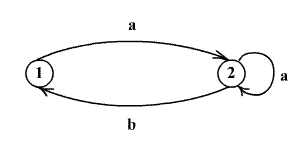

Когда у меня спрашивают про моё любимое число, то всегда отвечаю 23. А когда вопрос расширяют до "числа", то, конечно же, числа **Фибоначчи**.

Увидел вот такую задачу:\
> *С помощью автомата, изображённого на рисунке, строятся слова некоторой последовательности. Начальным состоянием автомата является 1, а допускающие: {1, 2}. Нужно определить сколько различных слов N(n) допускаются автоматом, в зависимости от длины слова n.\
> \*

Таким образом может быть получено лишь одно слово длиной 1 – "a", два слова длиной 2 – "aa" и "ab", три слова длиной 3, пять слов длиной 4...

Задача детская. Сгенерированное слово может оканчиваться как на "а", так и на "b". В последнем случае можно просто отбросить последний символ "b" и получить слово длиной n-1, и, соответственно, N(n-1) вариантов. Если же слово оканчивается на "a", то предпоследний символ обязан быть также "а", поэтому можем отбросить два символа с конца и получить N(n-2) вариантов. Значит,\
    N(n) = N(n-1) + N(n-2), N(0) = N(1) = 1, \
т.о. количество слов длиной n соответсвует n-ому числу Фибоначчи.

В принципе, ничего особого. Но просто удивительно в скольких дискретных задачах (и не только) встречаются  биноминальные коэффициенты, числа Бернулли, Эйлера, Фибоначчи опять же. 

Напрягся и вспомнил, что в **unix** этому автомату соответствует такое регулярное выражение: **'\(a\+b\)\+'** .
